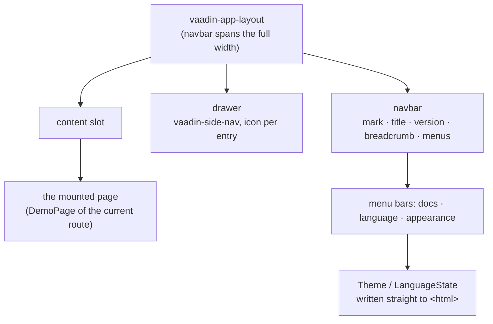
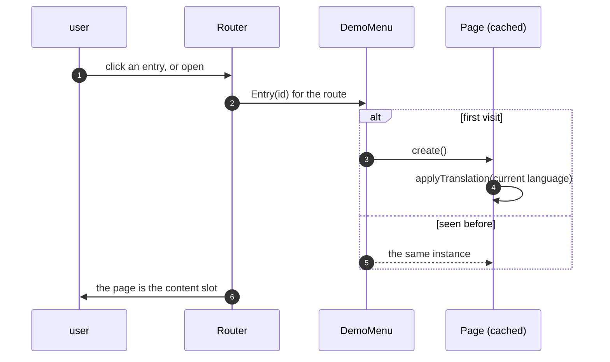

# Demo kit

`ktjs-demo-kit` is the frame a **live demo site** is built in — the site that documents a library and
doubles as its integration test. It is not a UI framework and it is not a page template: it is the
layout (app layout, drawer, navbar, menus), the page catalogue behind those menus, the language and
theme state, and the blocks pages are assembled from.

The demo of `ktjs-dom-kit` is an instance of it: the very pages you are reading the code examples from
were built as `Entry`s in a `DemoMenu` and mounted into one `DemoLayout`.

## Coordinates

```kotlin
implementation("io.github.shijianjs:ktjs-demo-kit:0.1.0")
```

It brings `ktjs-dom-kit`, `ktjs-vaadin-web-components` and `ktjs-iconify-icon` as `api` dependencies
(the layout is built out of Vaadin components and Iconify icons, and the page contract is spelled in
`HTMLElement`), so a demo project adds this one line and writes pages.

## What it gives you



| Package | Provides |
| --- | --- |
| `…ktjs.demo.layout` | [`DemoLayout`](./pages.md) and `LayoutConfig` — the site frame and its one config object; `LAYOUT_SHEET`, the class names the frame and its sheet agree on |
| `…ktjs.demo.nav` | `DemoMenu`, `Group`, `Entry`, `Page` and the hash `Router` behind them |
| `…ktjs.demo.i18n` | `Lang` (a BCP 47 tag, registrable), `LanguageState`, `Translations<T>` / `texts(…)` and `SiteTexts` |
| `…ktjs.demo.page` | [`DemoPage`](./pages.md) and the blocks: `paragraph`, `heading`, `anchor`, `codeText`, `bulletList`, `row`, `col`, `exampleBox`, `sectionBlock`, `Readout` |
| `…ktjs.demo.style` | `Theme` / `ThemeMode` (light / dark / follow-the-browser), `Palette` (the Lumo custom properties the site paints with) and `RESET`, the shared reset sheet |

## Wiring a site

A demo's `main` is the same three steps every time: create the state, define the tag, mount the config.

```kotlin
fun main() {
    val language = LanguageState()          // starts with English + Simplified Chinese
    language.init()                         // applies the stored language to <html lang>
    val theme = Theme()                     // Light / Dark / System, persisted
    theme.applyStored()

    DemoLayout.define()
    val layout = document.getElementById(ElementId("demo")) as? DemoLayout ?: error("no <ktjs-demo-layout>")

    layout.mount(
        LayoutConfig(
            menu = siteMenu(),
            language = language,
            theme = theme,
            texts = siteTexts,
            siteVersion = KIT_VERSION,
            docsUrl = DOCS_URL,
            apiUrl = API_URL,
            sourceUrl = SOURCE_URL,
            logoSrc = "img/ktjs-dom-kit-logo.png",
        ),
    )
}
```

`LayoutConfig` is one object on purpose. A `mount(menu, language, theme, config, texts)` signature
grows a parameter per knob; one config means the layout can gain a sixth concern (`siteVersion`, a
feedback link, a base path) without every demo project editing its call site. Everything after
`siteVersion` is optional — a site with only a repository gets a link menu with one entry, and a site
with no URLs hides the menu entirely.

The element itself must come from the page (`index.html` declares `<ktjs-demo-layout id="demo">`); a
second layout built in `main` would leave the declared one empty and the site with two drawers.

## Languages

The kit ships two languages and treats a language as **data**, not an enum branch:

```kotlin
val language = LanguageState(languages = listOf(Langs.EN, Langs.ZH_HANS, Lang("ja")))

private val siteTexts = texts(
    Langs.EN to SiteTexts(siteTitle = "ktjs-dom-kit", …),
    Langs.ZH_HANS to SiteTexts(siteTitle = "ktjs-dom-kit", …),
    Lang("ja") to SiteTexts(siteTitle = "ktjs-dom-kit", …),   // registered by the application
)
```

- `Lang` is an external interface over a tag; `Langs` holds the two built-ins and `Lang("ja")` registers
any other tag the site has copy for.
- `LanguageState` keeps the list, the current value, the `localStorage` persistence and
  `document.documentElement.lang`; the language menu is built from the list, so a tag the site does not
  register simply never appears.
- `Translations<T>` is one text object per language. It falls back to the **first declared** language,
  which is why a newly registered language shows sensible copy before its own translation lands. The
  declaration order is the menu order.
- Switching is a walk over the mounted pages (`Page.applyTranslation`), never a rebuild: scroll position
  and whatever the user typed survive.

## DemoMenu and routing

```kotlin
class Entry(val id: String, val group: Group, val icon: String?, val create: () -> Page)
```

Groups are derived from the entries, so adding a page is one entry and nothing else. `id` is the route
(`#/stylesheets`) and the key `SiteTexts.pageTitles` is looked up by — an id missing from the map shows
the id itself, so a page appears in the navigation before its translations land.



Pages are created lazily on first visit and then cached, so a page's own state (typed input, opened
panels) survives navigating away and back.
