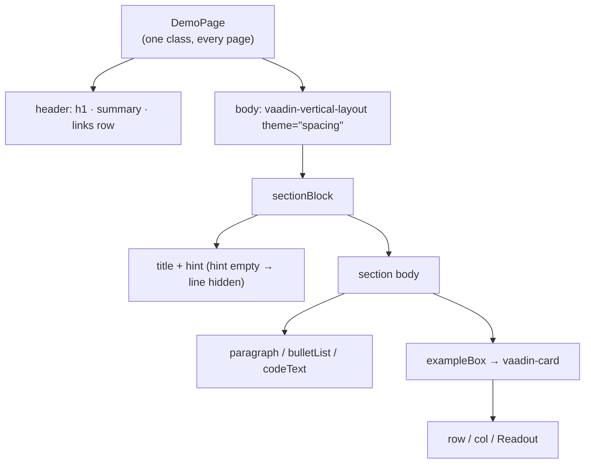

# Pages and blocks

Every page of a demo site is the same frame filled with different content: **one** `DemoPage` element
class for the whole site, not one class per page. Ninety pages do not need ninety tags — they differ in
content, not in chrome.

## The page frame



```kotlin
val page = newPage()
page.setTitle(current.pageTitle)
page.setSummary(current.summary)
page.addLink(anchor("API reference", apiUrl))     // the links row under the summary
page.body.append(section.root)                    // the body slot the page fills
```

| Member | Meaning |
| --- | --- |
| `body` | the block pages append sections to — a `vaadin-vertical-layout` with `theme="spacing"` |
| `setTitle` / `setSummary` | the `h1` and the lead paragraph of the page |
| `addLink(node)` | appends to the horizontal links row; the frame owns its layout |

`body` is a layout component, not a plain `div`, for one reason: a page stacks several section blocks,
each of which is itself a vertical layout. Boxes that stack without a gap end up touching — a card's
bottom edge against the next section's title. The gap belongs to the container, so a page does not put a
margin on every section it creates.

`DemoPage` is a **container**, not a base class: a page creates it, fills `body` and translates its own
strings. Nothing extends it.

## Blocks

The blocks cover what a documentation page actually says: a paragraph of prose, a heading, a code
fragment, a bullet list, an example box, and a titled section.

```kotlin
fun paragraph(text: String = ""): HTMLElement
fun heading(level: Int, text: String = ""): HTMLHeadingElement
fun anchor(text: String, href: String, external: Boolean = false): HTMLAnchorElement
fun codeText(text: String): HTMLElement
fun bulletList(items: List<String>): HTMLElement
fun row(vararg children: Node): HorizontalLayoutElement      // vaadin-horizontal-layout, spacing
fun col(vararg children: Node): VerticalLayoutElement        // vaadin-vertical-layout, spacing
fun exampleBox(caption: String? = null, vararg children: Node): CardElement
fun sectionBlock(): SectionBlock                             // title + hint + body
class Readout(initial: String = "")                          // text updated in place
```

The boxes are Vaadin components — `vaadin-vertical-layout`, `vaadin-horizontal-layout`, `vaadin-card`
with their `padding` / `spacing` variants — not hand-rolled CSS: gaps, padding and the card surface are
the component library's business, and the site styles only typography and the few colours that come from
`Palette`. A section is three nodes that belong together:

```kotlin
val section = sectionBlock()
section.setText(current.sectionTitle, current.sectionHint)   // empty hint hides the line
section.body.append(paragraph(current.explanation), exampleBox(current.caption, chip))
page.body.append(section.root)
```

`Readout` is for examples that show their own state: it updates the text in place instead of rebuilding
the node, which is the same rule the whole kit follows.

## Text, and what is not translated

A page owns a text class of its own (`OverviewTexts`, `AttributesTexts`, …) and declares it once:

```kotlin
private val texts: Translations<AttributesTexts> = texts(
    Langs.EN to attributesEnglish,
    Langs.ZH_HANS to attributesChinese,
)

override fun applyTranslation(lang: Lang) {
    val current = texts[lang]
    page.setTitle(current.pageTitle)
    section.setText(current.sectionTitle, current.sectionHint)
}
```

`applyTranslation` **rewrites the nodes the page holds**. It never rebuilds the tree, so a language
switch keeps scroll position and whatever the user typed or opened. Text derived from data — a member
signature, a resource path, a code snippet — is deliberately not translated: it would be a different
program, not a translation.

## Verifying a page

A demo page is a product page, so "it compiles" is not acceptance. Check it in a browser: the
structure inside the shadow trees, the computed styles (`getComputedStyle`), the number of `[style]`
nodes, and the console. The dom-kit demo does this with Playwright end-to-end tests that also capture a
screenshot per page per theme — the same run that produces the images on the demo site.
