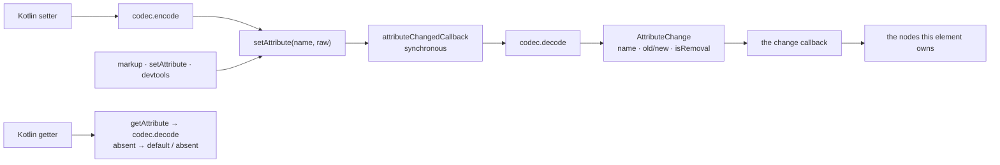

# Attributes

`attr` backs a Kotlin property with an HTML attribute:

```kotlin
class KtjsBadge : CustomElementAdapter() {
    var href: String by attr { change -> anchor.href = change.newValue }
    var height: Int by attr("height", default = 20) { change -> image.height = change.newValue }
}
```

The attribute is the property. The getter reads and decodes it, the setter encodes and writes it, and
nothing is kept on the Kotlin side except the last reported value, which exists only to tell a real
change from a repeated write. Markup, `setAttribute`, devtools and Kotlin all end up in the same
place, so there is no second copy to keep in sync.



External writes arrive through the browser's own `attributeChangedCallback`, which is synchronous and
only fires for attributes the element's class lists in its static `observedAttributes`. A `by attr`
property therefore needs its name in that list — see
[the registration contract](custom-elements.md#observedattributes-is-the-contract).


`attr` is an inline function taking `name`, `default`, `codec` and the change callback, all optional:

```kotlin
var logoSrc: String by attr                                              // logo-src
var ratio: Double by attr("data-ratio", default = 1.0) { … }             // explicit name
var kind: ActionKind by attr(codec = enumAttributeCodec(ActionKind.entries), default = ActionKind.Primary)
```

## Naming

The attribute name defaults to the property name in kebab case: `maxCount` → `max-count`,
`XMLHttp` → `xml-http`. A dash goes before an upper-case letter that starts a word; digits and
existing dashes are left alone.

Native spellings are not special-cased. `tabIndex` needs `attr("tabindex")`, and a property whose
name is already an `HTMLElement` member (`title`, `id`, `hidden`) has to be named differently and
mapped explicitly:

```kotlin
@JsName("titleText")
var titleText: String by attr("title") { change -> heading.textContent = change.newValue }
```

**Add `@JsName` when JavaScript should see the property.** Kotlin/JS compiles a delegated property to
module-mangled accessor methods and *no* JS property, so `element.titleText = "x"` from the page
silently writes a new expando field instead. `@JsName("titleText")` is what makes it emit real
`get`/`set` accessors. Kotlin callers do not need it. That is also the reason the property name and
the attribute name are two different things in this API — `titleText` is what TypeScript sees,
`title` is what the browser stores, and `@JsName` + `attr("title")` is the bridge between them.

## Values and codecs

The value is converted by an `AttributeCodec<T>`. The built-in ones:

| Codec | Property type | Behaviour |
| --- | --- | --- |
| `StringAttributeCodec` | `String` | verbatim; a missing attribute reads as `""`, so a `String` property is never null |
| `BooleanAttributeCodec` | `Boolean` | presence, like `hidden` — `<x flagged>` and `<x flagged="false">` are both `true`; `true` writes a bare attribute, `false` removes it |
| `IntAttributeCodec` | `Int` | `toIntOrNull`; anything else falls back to `default` (or `0`) |
| `DoubleAttributeCodec` | `Double` | `toDoubleOrNull`; falls back to `default` (or `0.0`) |
| `TokenListAttributeCodec` | `List<String>` | space-separated tokens (`theme="primary small"`); deduplicated on write, an empty list removes the attribute. On wrapper elements use `tokenListAttribute(name)` instead, see below |

Anything else is an `AttributeCodec<T>` implementation — three functions, no serialization library:

```kotlin
object InstantCodec : AttributeCodec<Instant> {
    override fun encode(value: Instant): String = value.toString()
    override fun decode(value: String): Instant? = runCatching { Instant.parse(value) }.getOrNull()
    override val absent: Instant = Instant.EPOCH
}
```

`decode` returning `null` is treated exactly like a missing attribute — the delegate falls back to its
`default`, or to `absent`. Decoding never throws, so a typo in the markup cannot break the element.

Enums need a codec because Kotlin/JS cannot enumerate one through reflection. `enumAttributeCodec`
takes the values explicitly and matches case-insensitively against a label (the lower-cased constant
name by default), also accepting the constant name itself when decoding:

```kotlin
enum class ActionKind { Primary, Secondary }

var kind: ActionKind by attr(codec = enumAttributeCodec(ActionKind.entries), default = ActionKind.Primary)
```

## Attributes on someone else's element

`attr` belongs to *your own* component: it registers itself, reports changes and owns a default. A
wrapper element from another repository (`createButton()` → `ButtonElement`) is an `external` class
you cannot add members to, so there the attribute is an **object bound to that element**, and an
extension property hands it out:

```kotlin
val ButtonElement.labelText: Attribute<String> get() = attribute("aria-label")

button.labelText.value = "Close"   // aria-label="Close"
button.labelText.value             // "Close"
button.labelText.present           // true
button.labelText.raw               // "Close"
button.labelText.clear()           // attribute removed
```

Four factories cover the built-in types, so no call site has to spell out a type parameter:

| Call | Value type | Missing reads as |
| --- | --- | --- |
| `attribute(name)` | `String` | `""` |
| `booleanAttribute(name)` | `Boolean` | `false` |
| `intAttribute(name)` | `Int` | `0` |
| `doubleAttribute(name)` | `Double` | `0.0` |

Anything else goes through `attribute(name, codec)` with the same codecs `attr` uses — an enum, a
timestamp, JSON:

```kotlin
val kind: Attribute<ActionKind> get() = attribute("kind", enumAttributeCodec(ActionKind.entries))
```

The class stays generic because the codec family is one system (`enumAttributeCodec`, custom codecs
and `attr` all speak `AttributeCodec`); what you never write at a call site is `<String>` — the
factory already knows it. An object is two fields, so building one per property access costs nothing.

It holds **no state and no registration**: `value` reads through `getAttribute` and writes through
`setAttribute`, so a value written by another component, by devtools or by a raw `setAttribute` is
visible on the next read — there is no cached copy that can drift. How to treat "missing" and what to
do when it changes is the business of the element's owner, not of the attribute, which is why both
are absent here rather than defaulted like `attr`.

**There is no `by` variant, and that is exactly why this is an object**: a wrapper element is
`external`, the only property you can declare on it is an extension property, and Kotlin does not
delegate those. The extension property therefore hands out the operation object instead of standing in
for the value.

### Token lists

Attributes whose value is a set of space-separated words (`theme`, `aria-describedby`, `data-tags`)
get their own object, obtained with `element.tokenListAttribute(name)`:

```kotlin
// one declaration, next to the elements it describes — the page calls `themeAttr` everywhere
val ThemePropertyMixin.themeAttr: TokenListAttribute
    get() = unsafeCast<HTMLElement>().tokenListAttribute("theme")

button.themeAttr.add("primary")            // theme="primary"
button.themeAttr.toggle("small")           // theme="primary small"
button.themeAttr.contains("small")         // true
button.themeAttr.remove("primary")         // theme="small"
button.themeAttr.value = listOf("a", "b")  // replaces the whole list
button.themeAttr.clear()                   // attribute removed
```

Writes are normalised: single spaces, duplicates dropped, order kept; an empty list removes the
attribute, so "no tokens" and "absent" are one state, exactly like an empty `class`. Every call reads
and writes the attribute itself — no in-memory set to keep in sync, no `DOMTokenList` exceptions for
odd syntax (a malformed value simply is not a token) — and `values` / `raw` show what the browser
actually stores. `TokenListAttributeCodec` remains for the `attr` side, where a delegated
`List<String>` property is what you want.

## `AttributeChange`

The callback receives the change, not just the new value, so a name, a removal or the raw strings are
available without changing the signature later:

| Member | Meaning |
| --- | --- |
| `name` | the attribute name, e.g. `max-count` |
| `oldValue` / `newValue` | decoded values; equal on the first report |
| `oldRaw` / `newRaw` | raw strings; `null` when the attribute is absent |
| `isRemoval` | `true` when the attribute was removed rather than written |

`newRaw == null` is what tells a removal apart from a value that happens to decode to the default.

## `default` is not written to the markup

`default` is what the getter reports while the attribute is absent — a Kotlin-side value, not a
declaration. Removing the attribute goes back to it. Writing it into the markup is opt-in and happens
in one place:

```kotlin
override fun connectedCallback() {
    applyInitialAttributes()                          // defaults stay in Kotlin
    applyInitialAttributes(writeDefaults = true)      // …and are copied into the markup first
}
```

## When the callback runs

- **From the setter:** synchronously.
- **From outside** (`setAttribute`, devtools, another element): synchronously too — inside the very
  `setAttribute` call. The browser routes it to `attributeChangedCallback`, which forwards to the
  delegate of that attribute name, so the property already reports the new value when the writing
  line returns. A removal takes the same path, with `newValue == null`.
- **On upgrade:** once per attribute the element already carried when
  `customElements.define` upgraded it, so markup parsed before the class was defined is reported
  without any help.
- **On connect:** from `applyInitialAttributes()`, which is now the catch-up rather than the main
  path: it reports whatever the current attributes say, and with `writeDefaults = true` it first
  copies the defaults in. It is idempotent — a delegate that has already reported a value is skipped
  — so calling it again on a reconnect does not repaint anything.

Only real changes are reported. Writing the same decoded value again is not a change; removing the
attribute is. A callback that writes its own property does not re-enter itself, so an element can
normalize what it was given.

## What a string assigned from JavaScript means

A property is also the element's JS-facing API, and a JS caller only has the value it was given.
React 19 assigns every matching JSX prop to the property, so `<ktjs-action kind="secondary">` arrives
as the **string** `"secondary"` even though the property's type is `ActionKind`.

The delegate therefore treats a string as the attribute's raw form — exactly the text `setAttribute`
would have stored — and only a value of the property's own type goes through the codec. For `String`
the two are the same thing, since that codec is the identity. Skipping this is a subtle bug: a full
page load is fine (React only reconciles during hydration, it does not reset props), while a
client-side navigation to a page whose element React creates throws a `ClassCastException` inside the
codec and replaces the page with an error boundary.

## Only reflecting properties belong here

`attr` writes the attribute, so it is for properties whose value *is* the attribute — what the markup
declares and CSS can select on. `input.value` is not one of those: it is internal state that outlives
the attribute, so it stays an ordinary property.
