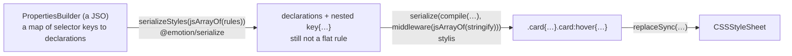
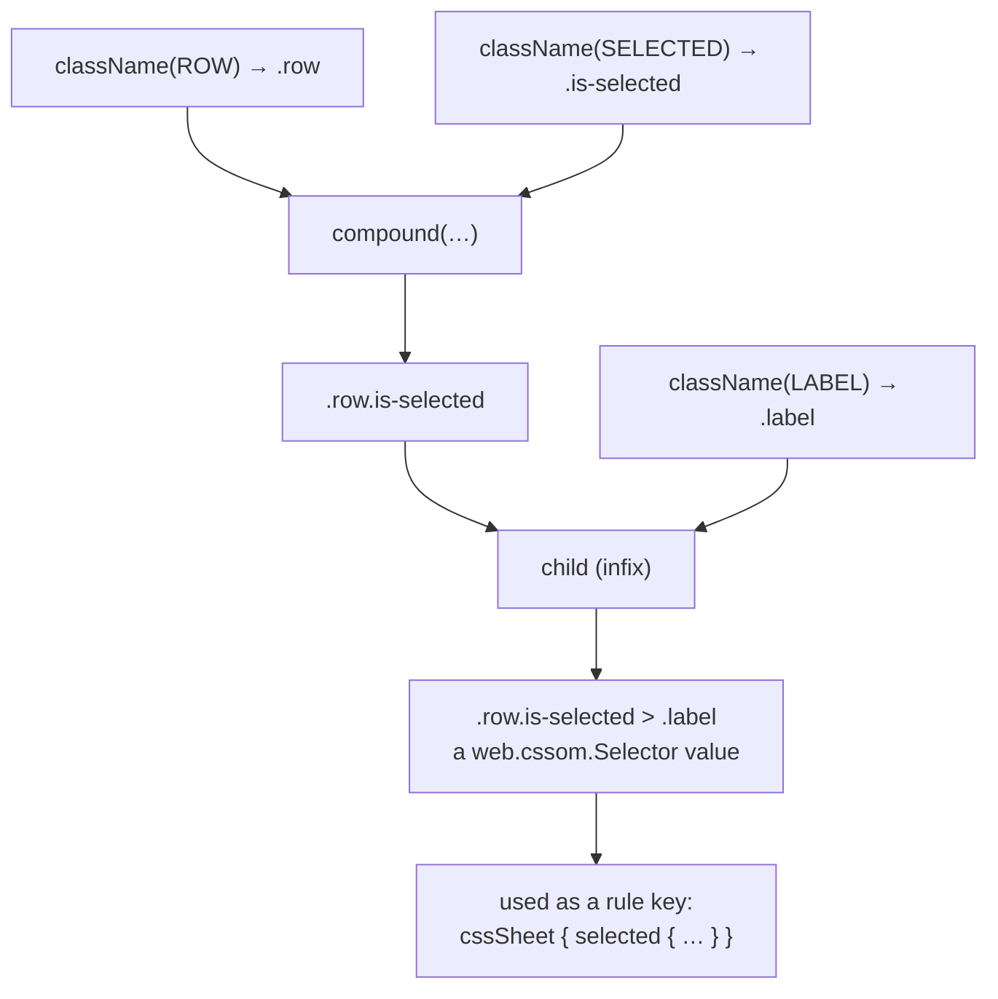

# Typed stylesheets

`cssSheet { … }` builds a `CSSStyleSheet` from a csstype rules object: rules, values, units and
pseudo-class structure all come from types, and the only strings left are the ones that genuinely
have no type — a custom property name, an `:nth-child` formula, the identifier in `::part(name)`.

The runnable side-by-side experiment (three ways of writing the same rule, plus a card that adopted
the sheet) belongs to the [ktjs-docusaurus](https://github.com/shijianjs/ktjs-docusaurus) repository —
`probes/web-components`, entry point `example.CssSheetExperiment`. Run it from that checkout:

```bash
./gradlew :probes-web-components:jsBrowserDevelopmentRun
```

## What it solves

The problem with hand-written CSS text is not its length, it is the reach of the magic strings:
property names, value units and pseudo-class structure are all spelled by hand, and a typo only shows
up the next time someone eyeballs the rendered page.

```kotlin
internal val CARD_SHEET: CSSStyleSheet = cssSheet {
    cardClass {                                   // selectors are a ClassName, see below
        border = Border(1.px, LineStyle.solid, `var`(cardBorderHook, NamedColor.black))
        transition = many(Transition(PropertyName.borderColor, 0.2.s, TransitionTimingFunction.ease))
        Pseudos.hover { borderColor = `var`(accentHook, `var`(primaryColorHook)) }
    }
}
```

The same rule is about 455 characters of hand-written CSS. In this form there are zero characters of
hand-written CSS, zero casts, and the only remaining strings are the theme's custom property names;
state variants come from `Pseudos`, with no hand-written key at all.

The measure of whether this is worth it is **how much CSS text is still written by hand**, not how
many lines of Kotlin it takes — a rule whose whole body is `"@media (max-width: 576px)"` strings is
no better than a text file.

## The pipeline and its contract



- **The top level is a map of selectors**, not a set of declarations. `cardClass { … }`,
  `Pseudos.hover { … }`, `pseudo(Pseudos.host) { … }` and `"@media …" { … }` are keys; a property
  written inside one belongs to the rule of the nearest enclosing block.
- `serializeStyles` takes an **array** (it is the tagged template's `strings` in emotion):
  `serializeStyles([rules])`. Passing the object itself makes it read `args[0]` and emit an empty
  string.
- Only `stringify` is installed, no `prefixer`: the prefixer adds `-webkit-` / `-ms-` fallbacks, and
  emotion 11 does not use it either.
- The versions are pinned to the ones `@emotion/cache` itself pins: `@emotion/serialize` 1.3.3 +
  `stylis` 4.2.0.
- Serialization happens **in the browser** (`CSSStyleSheet` does not exist in Node), so a module that
  holds a sheet can only be part of the browser bundle.

## Writing rules

### Selectors: `ClassName` + `invoke`

`RuleBuilder` has an `operator fun ClassName.invoke(block)`, which writes the dot:

```kotlin
private val cardClass = ClassName("card")   // the same object can be reused as element.className

cssSheet { cardClass { … } }
```

Trap: `ClassName("card") { … }` **does not compile** — Kotlin reads it as "call the factory, with the
trailing lambda as a second argument". Use parentheses for a one-off (`(ClassName("card")) { … }`),
or store it in a `val` and call `cardClass { … }`.

Pseudo-classes and pseudo-elements come from the module's own `css/dsl/Pseudos.kt`, which lists all 64 of
`csstype.SimplePseudosRuleBuilder`'s selectors plus the Web Components `:host`. Each constant **is the
pseudo text alone** — `Pseudos.hover` is `":hover"`, `Pseudos.before` is `"::before"`:

```kotlin
Pseudos.hover { … }                                  // the same shape as the official hover { }
pseudos(Pseudos.hover, Pseudos.focusVisible) { … }   // one block for "&:hover,&:focus-visible"
Pseudos.before { … }
many(Pseudos.hover, Pseudos.focusVisible)             // a combined Pseudo, too
```

The short form comes from `context(builder: RuleBuilder<T>) operator fun Pseudo.invoke(…)`: the
context parameter picks up the `PropertiesBuilder` of the enclosing `cssSheet { … }` (Kotlin 2.2+
context parameters; this repository is on 2.4 and needs no flag), and the call site imports
`io.github.shijianjs.ktjs.dom.css.dsl.invoke`. It differs from the official sugar in the two ways that
matter: it **attaches** the pseudo to the rule with `&`, and it can combine (every comma-separated
branch gets its own `&`, otherwise stylis reads the later ones as descendants). `many(…)` produces a
`Pseudo`, so `(many(Pseudos.hover, Pseudos.focusVisible)) { … }` works — the parentheses are required
(`many` is `vararg`, and a trailing lambda would be taken as another argument), which is why
`pseudos(…)` is the recommended form for a combined state. The explicit `pseudo(value) { … }` remains,
for when you already hold a `Pseudo` variable.

The colon is part of the value, and the kind is fixed when the value is created: `pseudoClass("hover")`
is `:hover`, `pseudoElement("before")` is `::before`. There is no `element = true` flag to pass at the
call site, because CSS never lets the same name be both. `&` is *not* part of the value either — it is
about where the variant is attached, so only the scope that writes it into a rule adds it. That is why
the same `Pseudos.hover` both invokes as a state (`&:hover`) and composes as a selector part:
`compound(className(ROW), pseudo(Pseudos.firstChild))` is `.row:first-child`.

**At-rules have official entry points — do not write `"@media …"` / `"@supports …"` strings:**

```kotlin
`@media`(MediaType.screen and maxWidth(576.px)) { … }   // csstype.RuleBuilder.@media

// SupportsQuery follows web.cssom.MediaQuery: both sides of a declaration are typed, and
// and/or/not combine them
supports(
    supportsDeclaration(webkitBackgroundClipName, BackgroundClip.text) or
        supportsDeclaration(PropertyName.backgroundClip, BackgroundClip.text),
) { … }
```

What the wrappers already provide (look for these in the IDE before writing your own):

| Entry point | Where | Use |
| --- | --- | --- |
| `RuleBuilder.@media / @container / @font-face / @view-transition` | `kotlin-csstype`'s `RuleBuilder.kt` | at-rule blocks; `@media(query)` takes a `MediaQuery` |
| `AtRules.media / supports / layer / page / scope / …` | `web.cssom.AtRules` | every at-rule keyword (`@JsValue("@media")`, …) |
| `MediaQuery.and / or / not` | `web.cssom.MediaQuery.kt` | combining conditions |
| `Selector("…")`, `Selector.invoke { … }` | `web.cssom.Selector.kt`, `RuleBuilder.kt` | a selector as a value — and as a rule key, since that is the type the rules object is keyed by |
| `MediaType.screen / print / all` | `web.cssom.atrule.MediaType` | media types |
| `maxWidth / minWidth / width / height / orientation / prefersColorScheme / prefersReducedMotion / …` | `web.cssom.atrule/*.fun.kt` | media features (a whole directory, about 30 of them) |
| `var / env / rgb / many / array / important / linearGradient / stop / Content() / NamedColor / PropertyName / translatex` | `web.cssom`'s `*.functions.kt`, `*.ext.kt`, `*.fun.kt` | values and functions |

**What is still a string**: application-level custom property names (`CustomPropertyName("--brand")`),
and the bare tokens CSS itself does not type — an `An+B` formula, a `::part` name, a language tag; those
take the factory of the type they belong to (`ident("2n+1")`). The selectors themselves are no longer
strings: `*` and `&` are constants of `Selectors`, `:host` / `:root` / `:scope` are constants of
`Pseudos` (they are pseudo-classes, so the same value also works as an argument to `pseudo(…)`), and
every HTML attribute name is a constant of `web.cssom.HtmlAttributes`.

### Selectors you build: `compound` + combinators

`css/dsl/Composition.kt` is an expression engine for selectors: every node kind is a factory, the
combinators are infix functions, and the result is `web.cssom.Selector` — cssom's own opaque selector,
the same type `csstype.RuleBuilder` keys a rule with. It is a value you can hold in a field, pass to a
function, and finally use as a rule key, with no conversion in between.

```kotlin
private val ROW = ClassName("row")
private val SELECTED = ClassName("is-selected")
private val BUTTON: TagName<HTMLButtonElement> = TagName("vaadin-button")

val selected = compound(className(ROW), className(SELECTED))         // .row.is-selected
val cell = className(ROW) child className(CLASS_LABEL)               // .row > .label
val hostDisabled = pseudo(Pseudos.host, attributeSelector(HtmlAttributes.disabled)) child tag(BUTTON)
                                                                     // :host([disabled]) > vaadin-button

cssSheet { selected { display = Display.block } }
```

`compound` and the combinators build one tree; the result is a selector value, not text:


| Node kind | Factory |
| --- | --- |
| type selector | `tag(HtmlTagName.div)` / `tag(BUTTON)` — a `TagName`, never a string |
| class, id | `className(ClassName("x"))`, `id("main")` |
| attribute | `attributeSelector(HtmlAttributes.disabled)` / `attributeSelector(HtmlAttributes.type, "text")` — the generated catalogue; the string form is only for names outside it (`aria-current`, `data-*`) |
| pseudo-class, pseudo-element | `pseudo(Pseudos.hover)`, `pseudo(Pseudos.before)`, `pseudo(pseudoElement("part"), ident("label"))`, `pseudo(pseudoClass("not"), className(HIDDEN))` |
| `*`, `&` | `Selectors.universal`, `Selectors.nesting` |
| compound (one element) | `compound(vararg parts)` |
| combinators | `descendant`, `child`, `nextSibling`, `subsequentSibling`, `column` (infix) |
| selector list | `selectorList(vararg selectors)` — commas |

**Attribute names come from the catalogue.** `web.cssom.HtmlAttributes` is a sealed interface of 210
constants, each holding the selector fragment with its brackets (`HtmlAttributes.type` is `"[type]"`);
there is no constructor, which is why `attributeSelector(…)` takes the constant and not a name. A value
is the second argument (`attributeSelector(HtmlAttributes.type, "text")` → `[type="text"]`), and the two
forms without a catalogue entry — ARIA, `data-*`, a project's own names — are the only ones left on the
string form. `tag(…)` and `className(…)` take `TagName` / `ClassName` only, so a new name is always a
`val` at the point it is declared.

A variant from `Pseudos` already *is* the selector part it looks like — `Pseudo` holds `:hover`, `&`
belongs to the scope that attaches it. So the same constant is both a state of the enclosing rule
(`Pseudos.hover { … }` → `&:hover`) and a part of a standalone selector
(`compound(className(ROW), pseudo(Pseudos.firstChild))` → `.row:first-child`). A bare `:host` rule key
is `pseudo(Pseudos.host)`: `Pseudos.host { … }` would attach `&` and produce `&:host`, which never
matches.

What the engine deliberately does not do:

- **No parsing.** `Selector(text)` takes whatever it is handed, for the one piece CSS does not type.
  It is not an entry point for a pasted selector — that is the string this API exists to replace.
- **No escaping of identifiers.** A class name that contains a space or a quote is a bug at the call
  site, not something to hide.
- **No re-formatting after rendering.** Combinators render with the spaces CSS writes
  (`.row > .label`); stylis compacts them inside the sheet (`.row>.label`), so a test that compares text
  compares the sheet.

A `vararg` factory (`compound(…)`, `selectorList(…)`) cannot take a trailing block: the lambda reads as
one more argument. Name the value (`val selected = compound(…)` and then `selected { … }`) or add
parentheses — the same trap as `many(…)`.

### Custom properties: a named constant + `var(name, fallback)`

```kotlin
private val accentHook = CustomPropertyName<Color>("--ktjs-accent")
private val shadowHook = CustomPropertyName<BoxShadow>("--ktjs-shadow")

color = var(accentHook, NamedColor.white)                       // var(--ktjs-accent,#FFFFFF)
boxShadow = var(shadowHook, BoxShadow(0.px, 10.px, 24.px, …))
```

The type parameter is the value the hook carries, so the fallback has to be a **typed value** of the
same type, not text. cssom has no constants for application-level property names, so the string
appears once, in a named constant, instead of scattered through the sheets.

### Named colours, multiple values, transitions

| Need | Write |
| --- | --- |
| a named colour | `NamedColor.white` (`@JsValue("#FFFFFF")`; the type is `Color`) |
| an arbitrary colour | `rgb(127, 127, 127, 0.24)`, `oklch(…)`, `Color("var(--x)")` (last resort) |
| comma-separated values | `many(a, b)`; space-separated ones `array(…)`; `!important` through `important(x)` |
| a transition | `Transition(PropertyName.borderColor, 0.2.s, TransitionTimingFunction.ease)`, several via `many(…)` |
| a fallback ladder | `fallback(Display.grid, Display.flex)` (emitted as two declarations of the same name) |
| shadows, borders, padding | `BoxShadow(0.px, 10.px, 24.px, rgb(…))`, `Border(1.px, LineStyle.solid, …)`, `Padding(…)` |

`PropertyName.borderColor` works as a transition property because `PropertyName<T> : Ident` and
`IdentType` includes `TransitionProperty` — so the fact that `TransitionProperty` only exposes `all`
does not get in the way, and **no cast is needed**.

### What cssom does not cover: fill the gap in `io.github.shijianjs.ktjs.dom.css.dsl`

Do not fall back to a text rule because "cssom does not have it", and do not scatter `unsafeCast`
into the call sites. Add the missing piece to this module's `css.dsl` package in the official style (one
`unsafeCast`, values stay typed) and keep writing typed code at the call site:

| Missing | Added in | Call site |
| --- | --- | --- |
| `radial-gradient(…)` | `css/dsl/Gradients.kt` | `radialGradient(RadialGradientShape.Circle, colorStop(glow), stop(Color.transparent, 70.pct))` |
| a colour stop with no position | `css/dsl/Gradients.kt` | `colorStop(color)` — cssom's `stop` always takes a position |
| `-webkit-background-clip` (property and name) | `css/dsl/VendorProperties.kt` | `webkitBackgroundClip(BackgroundClip.text)` (camelCase key, emotion hyphenates it), and `webkitBackgroundClipName` for the `@supports` condition |
| typed `@supports` conditions | `css/dsl/Supports.kt` | `SupportsQuery` + `supportsDeclaration(PropertyName<T>, T)` + `and`/`or`/`not`, modelled after `web.cssom.MediaQuery` |
| an `@supports` block (the only at-rule helper that was missing) | `css/dsl/AtRules.kt` | `supports(query) { … }`, with the keyword from `AtRules.supports` |
| pseudo-class / pseudo-element constants and combined states | `css/dsl/Pseudos.kt` | `Pseudos.hover` / `pseudo(…)` / `pseudos(…)` (64 constants) |
| building selectors out of parts | `css/dsl/Composition.kt` | `compound(…)`, `selectorList(…)`, `className` / `tag` / `attributeSelector` / `pseudo`, the combinators |

Two gaps cssom does *not* leave: `pointer-events: none` was a local constant for a while, but cssom
already types it as `web.cssom.None.none` (`None : NoneType`, and `NoneType` is a supertype of
`PointerEvents`, so it assigns to the property directly). Check the generated types before adding a
constant — search the symbol first, as the rule below says.

The rule for the additions: **values stay typed** (enums, utility types, `Length`); only the things
that cannot be typed — a property name — stay strings. One gap, one function or constant. Do not add
an escape hatch such as `putRaw(name, value)`: that is how the strings get invited back in.

## Traps

### The pseudo-class sugar has no `&`, and cannot express a combined state

`SimplePseudosRuleBuilder.hover` / `before` / `after` write the keys `":hover"` and `"::before"`,
without `&`. stylis then reads them as **descendant** selectors:

```
hover {}      -> .probe-sugar :hover{…}     ← not .probe-sugar:hover
"&:hover" {}  -> .probe-ampersand:hover{…}
```

The root cause is in kotlin-wrappers' generator: `karakum/csstype/Pseudos.kt`'s `convertSimplePseudo`
writes the string from the csstype union into the method body verbatim, while the hand-written
`RuleBuilder.and` in the same API does add `&` — as does `kotlin-css`'s `CssBuilder.hover`. Reported
as [kotlin-wrappers#2933](https://github.com/JetBrains/kotlin-wrappers/issues/2933).

**There is no reason to wait for it.** That sugar is one method per pseudo-class, so even with `&` it
could not express `"&:hover,&:focus-visible"` — one block shared by several states, which the
elements in this repository need. So `css/dsl/Pseudos.kt` builds its own layer, shaped after
`web.dom.TagName` + `web.html.HtmlTagName`:

- `external interface Pseudo` + `pseudoClass(name)` / `pseudoElement(name)` factories — the colon and
  the kind are decided where the value is created, so `Pseudo` holds exactly what CSS prints;
- `object Pseudos` listing all 64 strings of `SimplePseudosRuleBuilder` (plus `:host`), each constant
  the pseudo text alone (`Pseudos.hover` is `":hover"`, `Pseudos.before` is `"::before"`);
- `pseudo(pseudo)` / `pseudo(pseudo, argument)` turning a `Pseudo` into a selector part;
- `context(RuleBuilder<T>) operator fun Pseudo.invoke(block)`, so `Pseudos.hover { … }` reads like the
  official `hover { … }`; `&` is added here, by the scope that attaches it, and each comma-separated
  branch gets its own `&`;
- `RuleBuilder.pseudo(pseudo, block)` (the explicit form) and
  `RuleBuilder.pseudos(vararg pseudos, block)` (the latter joins the selectors with `web.cssom.many`);
  `many` also combines `Pseudo`s directly;
- `pseudoClass("not")` + an argument selector, and `pseudoElement("part")` + a name, for anything
  outside the list — the free-form part is the *argument*, never the kind.

### Do not replace the serializer with one `insertRule` per rule

That route (`insertRule(".x {}")` + `rule.style` assignments) also gets type checking, but CSSOM
**keeps only the last declaration of a property inside a rule**: a `fallback(a, b)` ladder collapses
to its last entry. The text path keeps the ladder, and the browser picks at parse time.

### The output is not byte-identical to hand-written CSS

Normalize before comparing, and never assert the whole string: `#fff` → `#FFFFFF`, `0` → `0px`,
sometimes no space after a comma; `-webkit-background-clip` and `background-clip` are the same
property in Chrome, so both are in the text and only one comes back out of CSSOM; and the `ease` in
`transition: border-color 0.2s ease` disappears when read back from CSSOM, while the text path keeps
it. Equivalence is what matters — assert semantic fragments (see `CssSheetTest` in this module's
`jsTest`).

### Vendor properties are written in camelCase keys

`webkitBackgroundClip(…)` puts the key **`WebkitBackgroundClip`** into the rules object, not
`-webkit-background-clip`: `@emotion/serialize` hyphenates camelCase keys itself. A key that is already
kebab-case is **rejected in development** (`Using kebab-case for css properties in objects is not supported.
Did you mean WebkitBackgroundClip?`) and the declaration is dropped, so the rule silently loses its
prefixed part. The opposite spelling is needed only for the `@supports` query, which is CSS text:
`webkitBackgroundClipName` stays `-webkit-background-clip`.

### One sheet serves every instance

The `CSSStyleSheet` returned by `cssSheet` belongs in the **component class's companion object**, and
every instance adopts it with `attachStyledShadow(HOME_RESET, SHEET)`. Do not build one in the
constructor: the rules are static, one is enough.

## Adoption in this repository

Every home element builds its sheet this way:

| File | What it holds |
| --- | --- |
| `HomeReset.kt` | the shared sheet: `*` / `*::before` / `*::after` / `:host` |
| `KtjsFeature.kt`, `KtjsStep.kt` | the card surface, plus `&:hover` / `&:focus-visible` |
| `KtjsAction.kt` | `:host > a` and the two pill classes with their hover states |
| `KtjsHero.kt` | the pseudo-element glow, the `@supports` gradient text and a `@media` block (using the `css` package's `radialGradient` / `webkitBackgroundClip`) |

Migrating one component: move the rules inline styles cannot express into `cssSheet { }`, run
`jsBrowserTest`, then read the sheet back (`element.shadowRoot.adoptedStyleSheets`) and compare it
semantically with the text it replaced — mind the normalization in the trap above — and delete the
text once they match.

## References

- csstype's rule DSL: `kotlin-csstype/src/webMain/kotlin/csstype/RuleBuilder.kt` (`Selector` /
  `ClassName` / `and`) and `…/generated/csstype/Simple*Pseudo*RuleBuilder.kt` (the pseudo sugar —
  see the trap above).
- cssom's value types: `kotlin-cssom-core/src/webMain/generated/web/cssom/` (the `*Property.kt`
  types and the `*.functions.kt` factories: `Border`, `BoxShadow`, `Transition`, `Gradient`, `Color`,
  `NamedColor`).
- cssom's hand-written helpers: `Reference.functions.kt` (`var` / `env`), `many.kt`, `array.kt`,
  `important.kt`.
- Serialization: `@emotion/serialize`'s `serializeStyles`; stylis's `compile` / `serialize` /
  `middleware` / `stringify`.
- The experiment and its conclusions: the **ktjs-docusaurus** repository,
  `probes/web-components` (`CssSheetExperiment`).
