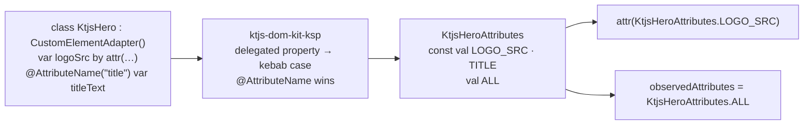

# Custom elements

A component is a Kotlin class that extends `CustomElementAdapter`, declares its attributes with
[`attr`](./attributes.md), and names its tag in a companion object that registers itself. No JavaScript
class literal, no component library, and no `@JsName`-aliased lifecycle hooks.

```kotlin
class KtjsBadge : CustomElementAdapter() {

    private val anchor = TagName<HTMLAnchorElement>("a").createElement()

    var href: String by attr { change -> anchor.href = change.newValue }

    init {
        // A shadow root may be attached from the constructor; appending to the element itself may not.
        attachShadowRoot().append(anchor)
    }

    override fun connectedCallback() {
        applyInitialAttributes()
    }

    companion object : CustomElementReferenceAdapter<KtjsBadge>(
      KtjsBadge::class.js, "ktjs-badge",
      observedAttributes = arrayOf("href"),
  )
}

val badge: KtjsBadge = KtjsBadge.NAME { href = "docs/intro" }
```

## What the adapter does

`CustomElementAdapter : HTMLElement()` takes over the three things a component would otherwise repeat
in every class:

1. **The lifecycle hooks**, declared as overridable methods under their native names:
   `connectedCallback`, `connectedMoveCallback`, `disconnectedCallback`, `adoptedCallback`,
   `attributeChangedCallback`. An element class writes `override fun connectedCallback()` and the
   browser calls it.
2. **The `attr` delegates** of its subclasses. Each property registers its delegate with the element
   when it is initialised, and the browser's synchronous `attributeChangedCallback` feeds every later
   change of a *registered* attribute back into the delegate of that name, so a property and its
   attribute cannot disagree — and they never do, not even for one microtask. See
   [Attributes](./attributes.md).
3. **The bridge removal** described below, through `stripBridgesFrom`.

## `observedAttributes` is the contract

`attributeChangedCallback` is the platform's own hook, and it only fires for attributes the class's
static `observedAttributes` lists. That list is read once, by `customElements.define`, so it has to
exist **before** the companion's `init` defines the tag — before any instance, and long before a
delegate exists. The names therefore come from the class declaration:

```kotlin
class KtjsAction : CustomElementAdapter() {
    var kind: ActionKind by attr(codec = enumAttributeCodec(ActionKind.entries))
    var href: String by attr

    companion object : CustomElementReferenceAdapter<KtjsAction>(
        KtjsAction::class.js, "ktjs-action",
        observedAttributes = arrayOf("kind", "href"),
    )
}
```

The price of a synchronous callback is that this list repeats what the `by attr` declarations already
say, and a forgotten name is not a loud failure: the property still reads the attribute, the initial
value still arrives (through `applyInitialAttributes()` or the upgrade callback), but a **later**
external write to that attribute goes unreported. Two guards against that:

- `applyInitialAttributes()` is the catch-up that runs once the element is connected, so a missed name
  still reports the markup it was created with.
- The generated list in the next section, which removes the repetition entirely — plus a test that
  compares it with what the properties actually registered.

## Generated attribute names

No Kotlin/JS class can see its own property declarations before it runs: the delegates are created in
the constructor, per instance, and `observedAttributes` is read earlier than that — at
`customElements.define`. The compiler is the one place that knows the declarations first, so
`ktjs-dom-kit-ksp` generates the names:



For every class extending `CustomElementAdapter`, the processor writes one `internal object` next to
it — the constants, and `ALL`, the array the browser reads:

```kotlin
internal object KtjsHeroAttributes {
    const val LOGO_SRC: String = "logo-src"
    const val TITLE: String = "title"
    val ALL: Array<String> = arrayOf(LOGO_SRC, TITLE)
}
```

The element then uses those constants for both halves, so the literal exists once:

```kotlin
class KtjsHero : CustomElementAdapter() {
    var logoSrc: String by attr(KtjsHeroAttributes.LOGO_SRC)

    @AttributeName("title")                                    // the attribute is not `title-text`
    var titleText: String by attr(KtjsHeroAttributes.TITLE)

    companion object : CustomElementReferenceAdapter<KtjsHero>(
        KtjsHero::class.js, "ktjs-hero",
        observedAttributes = KtjsHeroAttributes.ALL,
    )
}
```

A name is derived from the property name in kebab case — the same rule `attr` applies when it is not
given one — unless `@AttributeName` says otherwise. Which properties are attributes at all is
`isDelegated()`: inside an adapter, the only delegated properties are `attr` ones. Two properties
mapping to the same attribute is reported as a compile error.

Wire it in two lines, next to the element's own module:

```kotlin
plugins { id("com.google.devtools.ksp") }

dependencies { add("kspJs", project(":ktjs-dom-kit-ksp")) }
```

`AttributeProbe` in this repository's browser tests is the reference wiring: the processor runs over
`jsTest`, and `theGeneratedListMatchesTheDeclarations` compares `ALL` with the names the properties
registered, so a name the processor misses fails the build instead of going quiet.

## The official `CustomElement` interface

The adapter is `CustomElementAdapter : HTMLElement(), CustomElement.WithCallbacks`. Declaring the hooks
as `override fun`s is what makes the interface work: `web.components.CustomElement` declares them as
`val`s, Kotlin compiles an `override val connectedCallback` into a **getter**, and the browser only
looks for a method — the element would render and every callback would be silently skipped.
`CustomElement.WithCallbacks` is the variant that spells them as functions, so overriding
`connectedCallback` here is the method the browser calls, once, in the base class instead of in every
element.

## The self-recursive bridges

Kotlin/JS emits a forwarding member on a class for every external DOM member it inherits
(`ParentNode`, `ChildNode`, `Animatable`, `HTMLOrSVGElement`, `EventTargetLike`, …). The generated
member calls itself:

```js
querySelector(selectors) { return this.querySelector(selectors); }
```

The first call inside `connectedCallback` that goes through one of those names — `querySelector`,
`querySelectorAll`, `append`, `animate`, `focus`, `addEventListener`, … — recurses until the stack
overflows. `getAttribute` / `setAttribute` / `hasAttribute` / `textContent` need no fix: they are
abstract members of the external `Element` class, so no bridge is generated for them at all.

Reported upstream as
[kotlin-wrappers#2932](https://github.com/JetBrains/kotlin-wrappers/issues/2932) and, on the compiler
side, as [KT-91505](https://youtrack.jetbrains.com/issue/KT-91505): the bridge is generated for
members declared `= definedExternally` on external *interfaces* (a member of an external *class* such
as `getAttribute` is abstract and stops at the `ABSTRACT` guard), it is named after its own target,
and the call inside it therefore resolves to itself. The JVM backend has a guard against exactly this
pattern (`isErroneousSpecialBridge`, KT-82651); the JS backend got one in Kotlin **2.5.20-Beta1**
(build `2.5.20-dev-4666`). 2.4.21 — the version this repository compiles with — is one of the listed
affected versions (alongside 2.2.20 and 2.5.0-RC), so the workaround still has to live here. Once the
toolchain is upgraded the compiler stops emitting those bridges, deleting them becomes a no-op, and
`stripBridgesFrom` can be retired from `defineIfMissing` and the public API in one change — the
element code itself needs no edit.

`stripBridgesFrom(klass)` deletes those names from every prototype in the class's chain, stopping
before `HTMLElement.prototype`, where they are the real DOM methods. Deleting a name that was never
bridged is a no-op, so the list can stay wider than a given class strictly needs. It walks the whole
chain on purpose: Kotlin puts a bridge on **each** class, so cleaning only `CustomElementAdapter`
would leave the element class's own copy in place.

After that, the normal spelling works — `querySelectorAll(...)`, `append(...)`, `animate(...)` — with
no `…Super` forwarders. (A `@JsName` alias is not even allowed on an override.)

## Defining the tag

```kotlin
companion object : CustomElementReferenceAdapter<KtjsBadge>(KtjsBadge::class.js, "ktjs-badge")
```

`CustomElementReferenceAdapter<T>(clazz, name, formAssociated, observedAttributes, register)` extends
the `web.components.CustomElementReference` the browser wants — the three original arguments are passed
through unchanged — and adds the two things an element needs on top: `NAME`, a typed `TagName<T>`, and
registration inside its `init`, which calls `defineIfMissing(NAME, this)` unless it was built with
`register = false`.

`defineIfMissing(tag, reference)` runs `stripBridgesFrom` and then `customElements.define`, and returns
immediately if the tag is already registered. The order matters and is the reason not to call
`customElements.define` yourself: defining a tag upgrades any matching element already in the
document, whose `connectedCallback` runs right away — before the bridges are gone, that is a stack
overflow. Calling it twice is safe, which is what makes it usable from a module that may be evaluated
more than once.

Because registration happens in the companion's `init`, **reading `NAME` is the whole protocol**: it
registers the tag (upgrading any markup already parsed) and creates the element in one step, and the
element's own methods are in scope inside `NAME { … }`.

```mermaid
flowchart TB
  D["companion object : CustomElementReferenceAdapter(X::class.js, \"tag\")"] --> I["init { if (register) defineIfMissing(NAME, this) }"]
  I --> S["stripBridgesFrom(klass)<br/>delete the forwarding bridges on every prototype,<br/>stopping before HTMLElement.prototype"]
  S --> R["customElements.define(tag, companion)"]
  R --> U["matching markup upgrades now"]
  U --> AC["attributeChangedCallback<br/>once per observed attribute the markup carried"]
  AC --> C["connectedCallback<br/>shadow subtree already built in the constructor"]
  C --> A["applyInitialAttributes()<br/>defaults, plus an idempotent catch-up"]
  N["X.NAME { … }"] --> R
```


| Piece | Comes from |
| --- | --- |
| `CustomElementReferenceAdapter<T>(T::class.js, "tag")` | `ktjs-dom-kit`; wraps `web.components.CustomElementReference`, registers in `init` |
| `NAME: TagName<T>` | the adapter; one tag name per element, and reading it registers and creates |
| `defineIfMissing` | `ktjs-dom-kit`; what the adapter calls, and what to call by hand only for a `register = false` tag |

## Creating an element

`TagName<T>.createElement { … }` wraps the typed `document.createElement(TagName<T>)`, so the tag
name decides the property type and the callback receives it without a cast:

```kotlin
val action = KtjsAction.NAME.createElement {
    kind = ActionKind.Primary      // the same property MDX writes as kind="primary"
    href = "docs/intro"
    textContent = "Get started"
}
```

## Constructor rules

The Custom Elements specification forbids a constructor from adding attributes or children to the
element itself. `attachShadow()` is explicitly allowed, so a component builds its subtree into its
shadow root:

```kotlin
class KtjsBadge : CustomElementAdapter() {
    init {
        attachShadowRoot().append(anchor)      // fine: the shadow root is not the element
        // this.setAttribute("…", "…")         // throws NotSupportedError on createElement
        // this.append(anchor)                 // same
    }
}
```

Two consequences worth knowing:

- **Do not set an attribute on the element in its constructor.** `document.createElement("ktjs-badge")`
  throws `NotSupportedError` when the constructed element already carries attributes (the parser and
  the upgrade path do not). A style the element always needs therefore goes on `:host` in its own
  sheet, not into a `style` attribute.
- **Listeners follow their owner.** A listener on one of the component's own nodes belongs in the
  constructor and needs no cleanup; a listener on `document`, `window` or `matchMedia` belongs in
  `disconnectedCallback`, guarded by a flag, because moving an element re-runs `connectedCallback`.
