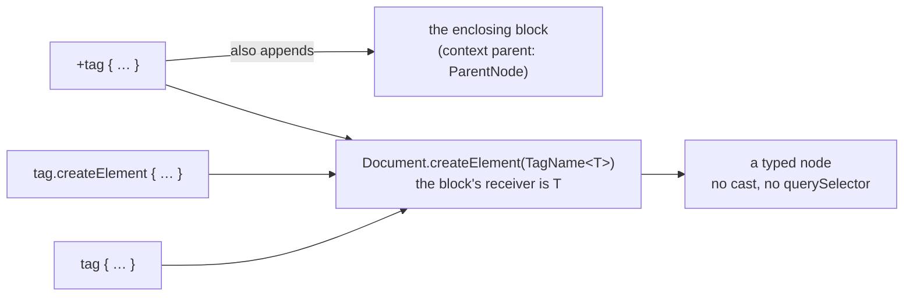

# Building elements

kotlin-browser gives every HTML tag a typed constant (`HtmlTagName.div`, `HtmlTagName.input`,
`HtmlTagName.tableCell`…), and dom-kit turns that constant into a way to build a node. Three
spellings, one element:

```kotlin
// 1. the explicit factory
val card = HtmlTagName.div.createElement { classList.add(CARD_CLASS) }

// 2. the same call written on the tag
val card = HtmlTagName.div { classList.add(CARD_CLASS) }

// 3. inside the block of the element that will contain it
val card = HtmlTagName.section {
    +HtmlTagName.div { classList.add(CARD_CLASS) }
}
```

All three go through `Document.createElement(TagName<T>)`, so the block's receiver is the element's
type — `HtmlTagName.anchor` hands you an `HTMLAnchorElement` with `href`, `target` and `rel` already
typed, and no cast or `querySelector` is needed afterwards.




## Which spelling

| Use | When |
| --- | --- |
| `+tag { … }` | Inside the block of the parent, which is most of the time: it creates *and* appends, and the expression value is the child so `val x = +tag { … }` keeps a reference. |
| `tag { … }` | The node's parent is decided elsewhere (returned from a function, put in a field, handed to `replaceChildren`). |
| `tag.createElement { … }` | You need the second parameter: building inside another document (`document.implementation.createHTMLDocument()`), or a chain where `createElement` reads better than a call. |

## `+` and where it comes from

`+` is `unaryPlus` on the created element, with a **context parameter** for the parent:

```kotlin
context(parent: ParentNode)
operator fun <T : HTMLElement> T.unaryPlus(): T
```

The parent is taken from the enclosing receiver, which is why the operator only exists where a
`ParentNode` is in scope — the block of an element, and nowhere else. A node held in a field or an
element that already exists has no parent to infer, so `parent.appendChild(node)` is the honest
spelling there; the compiler will not silently pick the wrong container.

Two consequences worth knowing:

- **Appending adds, it never clears.** Siblings keep insertion order, and a container that already
  has content keeps it — the same as repeated `appendChild`.
- **The value is the child, not the parent.** That is what makes both uses work: `+span { … }` for
  the side effect, `val note = +span { … }` for the node you will update on the next tick.

## What it does not do

- **No markup.** There is no `innerHTML`, no template string, no re-parsing: a node is created as a
  node, once.
- **No `querySelector` follow-up.** The created node already has its type; a builder holds it in a
  field instead of searching for it later.
- **No rebuild.** `+` on a list appends one entry; it does not touch its siblings, and nothing
  re-renders the page.

## Named helpers

When a shape repeats — a paragraph in body text, a code line in an example — a named helper is the
right level, and it still builds with the same call. The typed tag is the primitive; helpers are the
vocabulary on top of it, not a second way to create nodes.
