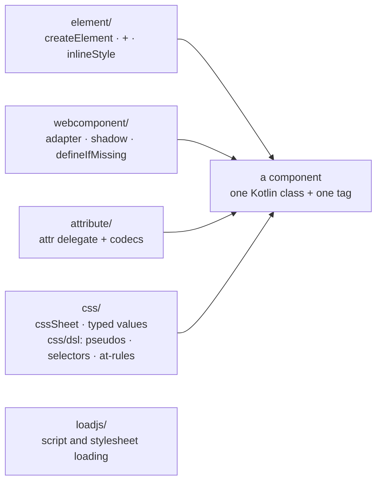
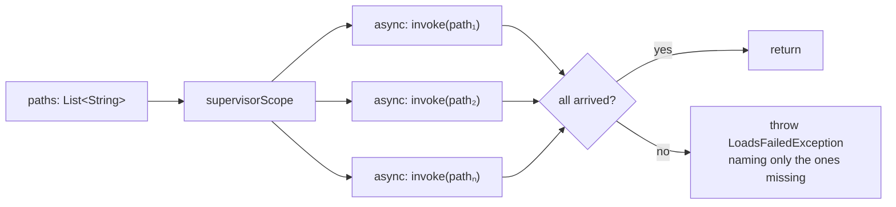
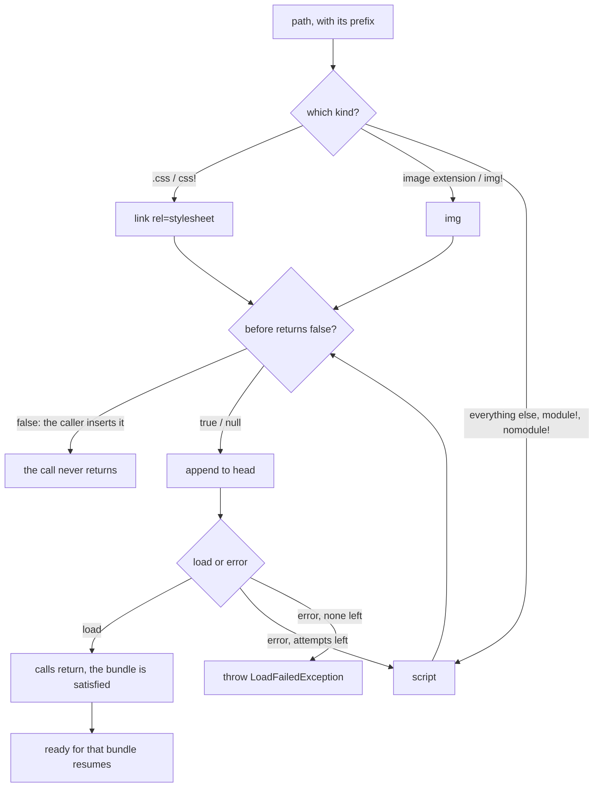

# DOM kit

`ktjs-dom-kit` is a published library: helpers for writing components in Kotlin/JS against the native
DOM, with no knowledge of any documentation framework and no component runtime behind them.

It is plumbing for UI code written without a UI framework — a base class a custom element can extend,
an attribute delegate that makes the DOM the single source of truth, a typed view of an element's
inline style, a way to build a `CSSStyleSheet` out of Kotlin values instead of CSS text, and a loader
for scripts, stylesheets and images ported from `loadjs`.

## Where it is used

The [ktjs-docusaurus](https://github.com/shijianjs/ktjs-docusaurus) site is built on it: every
`<ktjs-…>` element on that landing page extends `CustomElementAdapter` and styles itself with
`cssSheet { … }`. That is a consumer, not a parent — this repository publishes the artifact, and the
site depends on it the same way any other project would.

## Why its own repository

Nothing here wraps an npm package, so the version is a hand-written semantic one (`0.2.0`) rather than
the `{npm version}-kt.{revision}` scheme the npm-backed libraries in this repository follow. The one
npm dependency graph left is emotion's serializer, which `cssSheet { … }` uses to emit CSS text.

The repository is deliberately not one-library-per-project. A wrapper whose API is a handful of
declarations does not repay the cost of its own repository, CI, release pipeline and Pages site, so
small libraries land here as additional Gradle modules and get a directory in this site. The build
picks up every `ktjs-*` module automatically: publishing, Dokka and the version report need no edit.

## Coordinates

```kotlin
implementation("io.github.shijianjs:ktjs-dom-kit:0.2.0")
```

The artifact is published to Maven Central and its API reference is under `/api/` on this site.

## What is in it

The module is split by concern: a package per job, a subpackage wherever a package has an obvious
parent–child or one-to-many relation (a type and the implementations of it, a sheet and the sugar
written inside it), and a file per declaration — nothing here is a catch-all.




| Package | Provides |
| --- | --- |
| `element/` | the generic element helpers: `TagName<T>.createElement { … }`, its `HtmlTagName.div { … }` shorthand, the `+tag { … }` append operator ([Building elements](./elements.md)), and `HTMLElement.inlineStyle`, the element's own style seen as `csstype.Properties` |
| `webcomponent/` | what a custom element is built from: `CustomElementAdapter` (the lifecycle hooks under their native names, the `attr` delegate host), `CustomElementReferenceAdapter` (the companion that registers the tag), `defineIfMissing`, [`stripBridgesFrom`](./custom-elements.md), and `attachShadowRoot` / `attachStyledShadow` |
| `attribute/` | the `attr` property delegate: `attr`, `AttributeChange`, the provider and the delegate behind it, and the property-name rule; `attribute/types/` holds the codecs — one per type the delegate knows, plus `enumAttributeCodec` |
| `css/` | `cssSheet { … }` / `cssText { … }`, and the typed values cssom does not model (`RadialGradientShape`, `radialGradient`, `pointerEventsNone`, `SupportsQuery`, …); `css/dsl/` holds the sugar written inside a sheet — `Pseudos` / `pseudo` / `pseudos`, the `supports { … }` at-rule and `webkitBackgroundClip` |
| `loadjs/` | a Kotlin port of [`loadjs`](https://github.com/kubetail-org/loadjs): the `Loadjs` object (`Loadjs(…)` is the suspend load — one path, or a list of them — and `Loadjs.bundle(id)` hands out a bundle), the path prefixes (`css!`, `img!`, `module!`, `nomodule!`), and the per-bundle `load` / `ready` / `done` / `isDefined` |

### Loading scripts

`loadjs` is a package the build no longer resolves: the upstream source is ~320 lines of stable ES5,
so the loader lives here as Kotlin. That is one dependency fewer, one UMD function-object export less
to bind, and none of upstream's callback API — both calls suspend, so a caller already in a coroutine
awaits them without a bridge. The module depends on `kotlinx-coroutines-core` (`api`), so a page
writing `launch { … }` has the library already.

```kotlin
launch {
    Loadjs("/assets/app.js")                   // one file, no bundle: returns once it has run
    Loadjs(listOf("/assets/app.js", "/assets/app.css", "/assets/logo.png"))   // all at once
}

val assets = Loadjs.bundle("assets")           // the bundle, created on first mention
launch { assets.load("/assets/app.css") }
launch { assets.ready() }                      // returns once the bundle has arrived

assets.done()                // satisfies a bundle whose loading someone else does
Loadjs.isDefined("assets")   // was that id handed to a load since reset()?
Loadjs.reset()               // forget every bundle, its outcome and its waiters
```

The split is by scope: `Loadjs` is the page-wide half — the id-to-bundle table and the factory that
hands a bundle out — and everything about one url (the path, the element, the attempts, how the load
ended, who waits) is that bundle's own state, so `load` / `ready` / `done` are things a bundle does.
`Loadjs.bundle(id)` returns the same object for the same id, a bundle outlives the call that started
it, one that already finished answers `ready` at once from its outcome (failure included), and a
`ready` made before the load even started is resumed by that load.

The list form is the same thing run concurrently rather than a second code path: every path is one
`async` of the single call, so they are in flight together and it returns when all of them have
arrived — or throws `LoadsFailedException(paths)` naming the ones that did not, with the rest left
loaded. There is no gather bookkeeping inside the loader, and a bundle id names one load, so the
list form takes none.



Both calls report failure by throwing: `LoadFailedException(path)` when the browser could not load
the file, after `numRetries` extra attempts; the same exception comes out of `ready` for a bundle
that failed. Loading a bundle that already loaded throws `BundleAlreadyDefinedException`.

Paths pick the element: `.css` or a `css!` prefix is a stylesheet, a known image extension or `img!`
is an image, everything else is a script; `module!` / `nomodule!` mark the two halves of a
module/fallback pair, and the half this browser cannot use is skipped while still counting as loaded.



A skipped path (`module!` where modules exist, see above) stops before `script` is created and counts
as loaded, so it never reaches the `before` hook either.

The knobs are default and named parameters — `numRetries` and `before`, which sees the element right
before insertion and returns `false` to insert it yourself. Upstream's `async` knob is not carried
over: a script the loader creates is a dynamic script, which the browser schedules on its own terms
whatever the attribute says, so the option promised something the loader could not deliver. An element
the loader did not insert never fires `load` / `error`, so the call that created it never returns:
the caller owns that element from then on.

The registry is the page's, as upstream's module-level caches were, which is why the loader is one
object rather than something to instantiate and pass around: `bundle` / `reset` and the one-shot
`invoke` are the only members that need that scope.

What the port drops is what only older browsers needed: the IE9–11 empty-stylesheet check and the
`rel="preload"` swap, plus the `onbeforeload` hook, which no current browser fires.

## What it does not do

- **No component model.** There is no state, no `render()`, no diffing and no UI runtime. A component
  builds its subtree once and mutates the nodes it owns from then on — see
  [home sections](https://shijianjs.github.io/ktjs-docusaurus/docs/kit/home-sections/) in the
  ktjs-docusaurus site for what that looks like in practice.
- **No HTML strings.** Nodes are created as nodes (`document.createElement` through a typed
  `TagName<T>`), never assembled from markup and re-parsed.
- **No `<style>` nodes.** A component's own style is either inline declarations on the node
  (`inlineStyle`) or a `CSSStyleSheet` adopted by a shadow root; a sheet belongs to the class, not to
  the instance.

## The pages

- [Building elements](./elements.md) — `createElement`, its call-on-the-tag spelling, and `+` for
  appending a child into the element being built.
- [Custom elements](./custom-elements.md) — the adapter, the lifecycle hooks, and defining a tag.
- [Attributes](./attributes.md) — the `attr` delegate and its codecs.
- [Styling](./styling.md) — inline styles, shadow roots and adopted sheets.
- [Typed stylesheets](./css-sheet.md) — `cssSheet { … }`: the serializer, the typed values, the
  traps, and what to do when cssom has no type for something.
