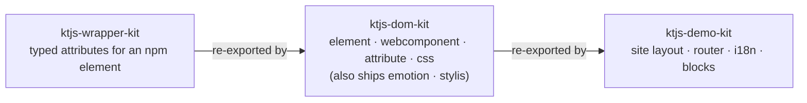

# Getting started

## Three modules, one dependency

This repository publishes three artifacts. Most projects want one of them:

| Artifact | For | Docs |
| --- | --- | --- |
| `ktjs-dom-kit` | writing components in Kotlin/JS | [DOM kit](../dom-kit/overview.md) |
| `ktjs-wrapper-kit` | giving an npm component's element typed attributes | [Wrapper kit](../wrapper-kit/overview.md) |
| `ktjs-demo-kit` | building the live demo site of a library | [Demo kit](../demo-kit/overview.md) |

Dependencies point one way: `ktjs-dom-kit` re-exports `ktjs-wrapper-kit`, and `ktjs-demo-kit` re-exports
both. A project that only describes npm components can depend on `ktjs-wrapper-kit` alone and stay clear
of the emotion/stylis side of the DOM kit.




## Add the dependency

```kotlin
kotlin {
    js {
        browser()
    }
    sourceSets {
        jsMain.dependencies {
            implementation("io.github.shijianjs:ktjs-dom-kit:0.2.0")
        }
    }
}
```

`kotlin-browser` and `kotlin-csstype` come with it as `api` dependencies: the public surface is spelled
in their types (`web.html.HTMLElement`, `csstype.Properties`), so a project that already uses
`kotlin-wrappers` needs no second set of DOM types.

## A first element

A component is a class extending `CustomElementAdapter` and a companion object that names its tag; the
companion registers itself, so there is nothing to call:

```kotlin
class KtjsChip : CustomElementAdapter() {
    private val label = HtmlTagName.span.createElement {
        inlineStyle.display = Display.block
    }

    /** `text`: the chip's caption. */
    @JsName("text")
    var text: String by attr { change -> label.textContent = change.newValue }

    init {
        // The constructor may not touch `this`, but the shadow root is its own tree.
        val shadow = attachStyledShadow(SHEET)
        shadow.appendChild(label)
    }

    // Nothing for connect: the base `connectedCallback` reports the markup the element was created
    // with, so a delegate whose name the array below forgets still hears its initial value.

    // `observedAttributes` lists the attributes `attributeChangedCallback` reports — one entry per
    // `by attr` property. The browser reads it once, when the tag is defined.
    companion object : CustomElementReferenceAdapter<KtjsChip>(
        KtjsChip::class.js,
        "ktjs-chip",
        observedAttributes = arrayOf("text"),
    ) {
        private val SHEET: CSSStyleSheet = cssSheet {
            pseudo(Pseudos.host) {
                display = Display.block
                padding = Padding(0.5.rem)
            }
        }
    }
}

val chip: KtjsChip = KtjsChip.NAME { text = "0.1.0" }
```

`CustomElementReferenceAdapter` keeps what the reference did — the class, `formAssociated`, the
observed attributes — and adds the tag name and its registration: `NAME` is a typed `TagName`, and the
companion's `init` calls `defineIfMissing(NAME, this)` unless it was built with `register = false`.
Reading `NAME` therefore both upgrades markup that is already on the page and creates a fresh element.

`defineIfMissing` strips the compiler-generated forwarding bridges from the class before it registers
the tag, which is what lets the element body call `appendChild` / `querySelectorAll` under their normal
names. Skipping it leaves an element whose first DOM call recurses until the stack overflows — see
[Custom elements](../dom-kit/custom-elements.md) for what is going on.

The element now takes markup and attributes like any other:

```html
<ktjs-chip text="0.1.0"></ktjs-chip>
<script type="module" src="./ktjs-chip.mjs"></script>
```

## Working in this repository

The build is a Gradle multi-project build; the library module is `ktjs-dom-kit` and the site is `docs`.

```bash
./gradlew build                       # compile, Detekt, browser tests
./gradlew :ktjs-dom-kit:jsBrowserTest
./gradlew :docs:docusaurusBuild       # the documentation site
./gradlew pagesSite                   # documentation at /, Dokka at /api/
./gradlew :docs:docusaurusStart       # dev server
```

`build` does not assemble the Pages site: that is what the Pages workflow runs.

| Path | Contents |
| --- | --- |
| `package.json` | the only place npm versions are declared (Dependabot maintains it) |
| `ktjs-dom-kit/src/jsMain/kotlin` | the library declarations |
| `ktjs-dom-kit/src/jsTest/kotlin` | browser tests for them |
| `docs/src/jsMain/kotlin` | the site configuration and sidebars |
| `docs/src/jsMain/resources` | Markdown pages, the MDX landing page, CSS, translations |

Chromium is downloaded by Playwright the first time a browser test runs; the tests themselves need JDK
21 and nothing else, because the Kotlin Gradle plugin installs npm for the workspace.

## The lock file

npm dependencies are resolved once for the whole workspace and pinned in
`kotlin-js-store/package-lock.json`. After adding or upgrading an npm dependency — or changing a
module's version — regenerate it:

```bash
./gradlew kotlinUpgradePackageLock
```

CI verifies the committed file, so a forgotten regeneration fails the build rather than drifting.
