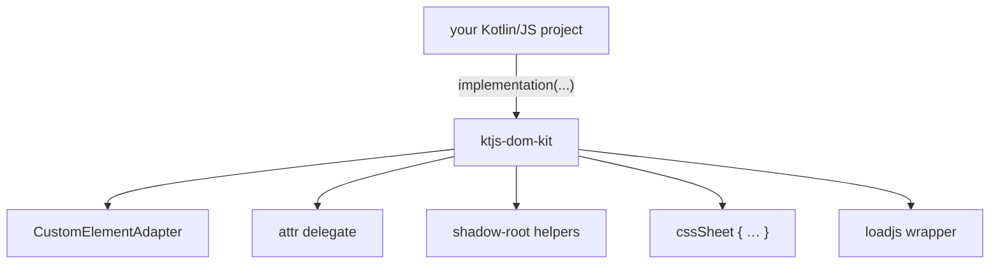

# Introduction

`ktjs-dom-kit` is a Kotlin/JS library for writing DOM components by hand: no UI framework, no
template language, no state-driven re-render. A component is a class that owns its nodes and mutates
them; attributes are the state; styles are either typed inline declarations or a `CSSStyleSheet`
adopted by a shadow root.

The library is published:

```kotlin
implementation("io.github.shijianjs:ktjs-dom-kit:0.1.0")
```

## What is in it

| Part | Role |
| --- | --- |
| `ktjs-dom-kit` | the library: `CustomElementAdapter`, the `attr` delegate, shadow-root helpers, `cssSheet { … }`, the `loadjs` wrapper |
| `docs` | this site: Kotlin configuration, Markdown pages, built by the [ktjs-docusaurus](https://github.com/shijianjs/ktjs-docusaurus) Gradle plugin |
| the rest | Detekt, Playwright browser tests, the Maven Central release through the hub, the Pages workflow |

The API reference under `/api/` is Dokka output for the published modules — the same Dokka run that
`pagesSite` assembles next to this site.

## One repository, several small libraries

Every library in this repository is a Gradle module named after its Maven artifact, and the build
picks up all of them: publishing, Dokka and the version report read the `ktjs-` prefix, so adding a
library means adding a directory and one `include` line.

The reason is cost: a wrapper whose API is a handful of declarations does not repay its own
repository, CI, release pipeline and Pages site. It lands here instead, gets a section in this site,
and every consumer resolves it from Maven Central like any other artifact. Docusaurus-scale wrappers
stay in their own repositories.

## Where to go next

- [Getting started](guide/getting-started.md) — add the dependency and write the first element.
- [DOM kit](dom-kit/overview.md) — what the library contains, package by package.

## How the pieces fit together


