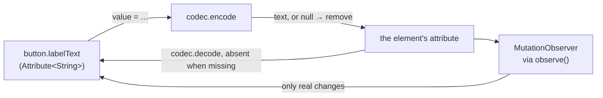

# Typed attributes

A wrapper element is an `external` class, so its attributes are reached through an object handed out
by an extension property:

```kotlin
val ButtonElement.labelText: Attribute<String> get() = attribute("aria-label")

button.labelText.value = "Close"      // aria-label="Close"
button.labelText.value                // "Close"
button.labelText.clear()              // the attribute is removed
```

`Attribute<T>` is **stateless**: every read goes through `getAttribute`, every write through
`setAttribute` and `removeAttribute`. Nothing is cached, so a value written by the npm component,
devtools or a plain `setAttribute` is visible on the next read — there is no second copy to keep in
sync. That is also why the extension property can build a fresh object per access.



## Reading and writing

| Member | Meaning |
| --- | --- |
| `value: T` | decoded value; assigning encodes it (an encoding of `null` removes the attribute) |
| `valueOrNull: T?` | like `value`, but `null` when the attribute is absent **or** unreadable |
| `raw: String?` | the attribute text exactly as the browser stores it |
| `present: Boolean` | whether the element carries the attribute at all |
| `setOrClear(value: T?)` | write, or remove when `value` is `null` |
| `clear()` | remove |
| `observe(onChange: (T) -> Unit): AttributeWatch` | react to any change, whoever wrote it |

`value` and `valueOrNull` differ on purpose: wrapper attributes are mostly optional, and absent is not
empty. `aria-label=""` and no `aria-label` are two different states; `value` answers the codec's
`absent` value for both, `valueOrNull` keeps them apart. Pair `valueOrNull` with `setOrClear`.

## Factories

```kotlin
fun HTMLElement.attribute(name: String): Attribute<String>                  // missing reads as ""
fun HTMLElement.booleanAttribute(name: String): Attribute<Boolean>          // presence, like hidden
fun HTMLElement.intAttribute(name: String): Attribute<Int>                  // unreadable → 0
fun HTMLElement.doubleAttribute(name: String): Attribute<Double>            // unreadable → 0.0
fun <T> HTMLElement.attribute(name: String, codec: AttributeCodec<T>): Attribute<T>
fun <T> HTMLElement.literalAttribute(name: String, values: List<T>, token: (T) -> String): Attribute<T>
fun HTMLElement.tokenListAttribute(name: String): TokenListAttribute
fun HTMLElement.jsonAttribute(name: String): JsonAttribute
fun HTMLElement.observeAttribute(name: String, onChange: (String?) -> Unit): AttributeWatch
```

### ARIA flags are properties, not attributes

ARIA values are text rather than HTML presence flags, so `booleanAttribute` cannot express them —
`aria-hidden="false"` hides nothing yet is still a *present* attribute. That does **not** call for a
custom accessor: `HTMLElement` inherits `ARIAMixin`, so every element already carries
`ariaHidden: AriaHidden?`, `ariaLabel: String?`, `ariaExpanded`, `ariaPressed`, `ariaCurrent`,
`ariaLive` and `role`. Write them as properties:

```kotlin
import web.aria.AriaHidden
import web.aria.`true`

icon.ariaHidden = AriaHidden.`true`        // aria-hidden="true"
```

The `true` / `false` members are companion extensions declared under that name on every ARIA union,
so importing the extension is enough — the receiver decides which union is meant, and no alias is
needed. Keep `setAttribute` only for the ARIA relationships that have no string property
(`aria-controls`, `aria-labelledby`).

### Literal attributes

`literalAttribute` is the typed form of a fixed vocabulary — `slot="navbar"`, `orientation="horizontal"`,
`data-size="small"`. The table is what turns a typo into a decode failure instead of a silently ignored
string, and a wrapper passes the table it already generates for its own vocabulary:

```kotlin
private val SLOTS = listOf("header", "content", "footer")

val CardElement.slotName: Attribute<String>
    get() = literalAttribute("slot", SLOTS, { it })

card.slotName.setOrClear("content")     // slot="content"
```

Decoding is case-insensitive, and text the table does not know reads as the **first** value — the rule
`LiteralAttributeCodec.absent` documents. A malformed attribute therefore degrades to something
renderable instead of throwing inside a component.

### Token lists

Space-separated vocabularies are **sets in disguise**. Read them as a list and add or remove tokens
instead of rebuilding the string:

```kotlin
val ThemePropertyMixin.themeAttr: TokenListAttribute get() = tokenListAttribute("theme")

button.themeAttr.add("small")
button.themeAttr.remove("contrast")
button.themeAttr.toggle("icon")
button.themeAttr.contains("primary")
```

`TokenListAttribute` keeps the attribute text canonical (single spaces, no duplicates) and removing the
last token removes the attribute. Unlike `DOMTokenList` it throws nothing for odd syntax: a malformed
value is simply not a token. `ktjs-vaadin` declares exactly this accessor on `ThemePropertyMixin` and
builds `addTheme` / `setTheme` / `removeTheme` on top of it.

### JSON attributes

A struct passed from markup (`data-options`) is an attribute whose text is JSON. `jsonAttribute` decodes
it into a `JsAny` and encodes the other way; it is the right tool for small structured payloads, not for
anything a component should hold as a typed field.

## Codecs

An `AttributeCodec<T>` is three members — `decode(text)`, `encode(value)` and `absent` — and that is the
whole extension point:

```kotlin
object InstantCodec : AttributeCodec<Instant> {
    override val absent: Instant = Instant(0)
    override fun decode(text: String): Instant = Instant(text.toDouble())
    override fun encode(value: Instant): String = value.millis.toString()
}

val TimelineElement.start: Attribute<Instant> get() = attribute("start", InstantCodec)
```

`encode` may return `null`, which removes the attribute: that is how an optional attribute says "not set"
without inventing a sentinel string.

## Observation

`observe` (and `observeAttribute` for raw text) hooks a `MutationObserver` and reports **real** changes
only — writing the same decoded value again, or `"3"` → `"03"` on an `Int`, does not fire. A removal
reports the codec's `absent` value. The returned `AttributeWatch` owns a live observer: disconnect it
when the element that registered it goes away, normally in the owning component's
`disconnectedCallback`.

## Why not `attr`

`ktjs-dom-kit` has an `attr` delegate that does more: it registers the attribute on the element, holds a
default and calls back with `AttributeChange` (old value, new value, raw text). That delegate needs a
Kotlin class to put the property in. A wrapper has none — its element class belongs to the npm package —
so the operation lives on an object, and registration, defaults and old values stay on the authoring
side. If you own the element, use [`attr`](../dom-kit/attributes.md); if you are describing somebody
else's element, use this module.
