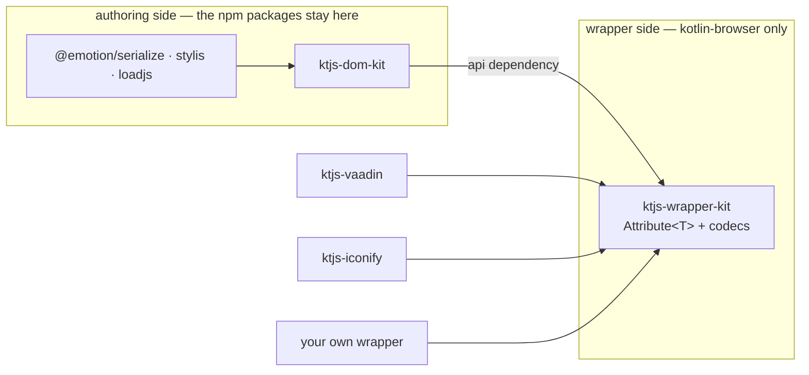

# Wrapper kit

`ktjs-wrapper-kit` is the **attribute layer for wrapper libraries** — the libraries in this repository
whose job is to mirror an npm package's components one-to-one (`ktjs-vaadin`, `ktjs-iconify`, …).

Those wrappers hand back `external` classes: `createButton()` returns a `ButtonElement` declared in
Kotlin but owned by the npm package. You cannot add a Kotlin member to an `external` class, and Kotlin
does not delegate extension properties, so a wrapper attribute cannot be a `by` property of the element.
It has to be an object the extension property hands out — see [Typed attributes](./attributes.md).

## What belongs here, and what does not

The split is by **npm dependency**, not by "which functions happen to be shared". `ktjs-dom-kit`'s
`jsMain` brings `@emotion/serialize`, `stylis` and `loadjs`; a library that only wants to read
`card.ariaLabel = "…"` should not be pulled into that. So this module depends on `kotlin-browser` and
nothing else, and both sides use it:



Arrows point from the dependent to its dependency: `ktjs-vaadin` and `ktjs-iconify` need the attribute
layer, and the attribute layer needs nothing but the DOM types.

Only the part a wrapper genuinely needs is here:

| Package | Provides |
| --- | --- |
| `io.github.shijianjs.ktjs.dom.attribute` | [`Attribute<T>`](./attributes.md) and its factories: `attribute`, `booleanAttribute`, `intAttribute`, `doubleAttribute`, `attribute(name, codec)`, `literalAttribute`, `tokenListAttribute`, `jsonAttribute`, `observeAttribute` |
| `…dom.attribute.types` | the codecs behind those factories — string, boolean, int, double, literal, token list, `enumAttributeCodec`, and `AttributeCodec<T>` itself for your own type |

Deliberately **not** here — these stay in `ktjs-dom-kit`, because they are for elements you *own*
(web components written in Kotlin) and they change as the kit's authoring side evolves:

- the `attr` delegate with registration, defaults and change callbacks (`AttributeChange`);
- `CustomElementAdapter`, `CustomElementReferenceAdapter`, `defineIfMissing`, `attachStyledShadow`, the shadow-root helpers;
- element creation (`TagName<T>.createElement { … }`, the `+tag { … }` operator);
- `HTMLElement.inlineStyle` and `cssSheet { … }`.

A wrapper uses none of those: it receives an element that the npm package already defined and themed.

## Coordinates

```kotlin
implementation("io.github.shijianjs:ktjs-wrapper-kit:0.1.0")
```

`kotlin-browser` comes with it as an `api` dependency, so `HTMLElement`, `Node` and `TagName` are in
scope without a second line. `ktjs-dom-kit` re-exports this module, so a project that already depends
on the DOM kit does not need to declare it again.

## A stable surface, on purpose

A wrapper's version has a second coordinate — `ktjs-vaadin` pins a wrapper-kit version on every
release, and Maven Central quota is finite. This module therefore treats its attribute API as the
stable face of a `0.x` library: it grows by addition, and the factories above are the single entry
point, so a generated attribute in a wrapper never writes its own reading and writing code.
