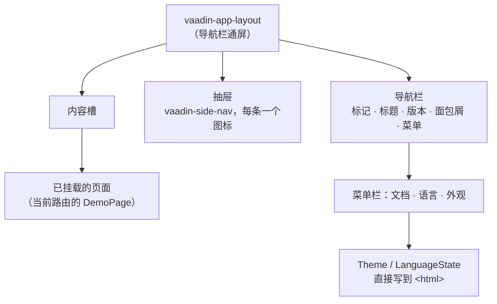
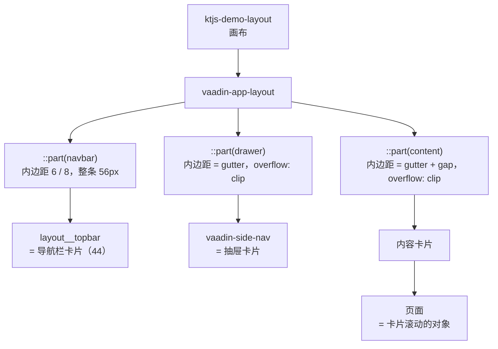
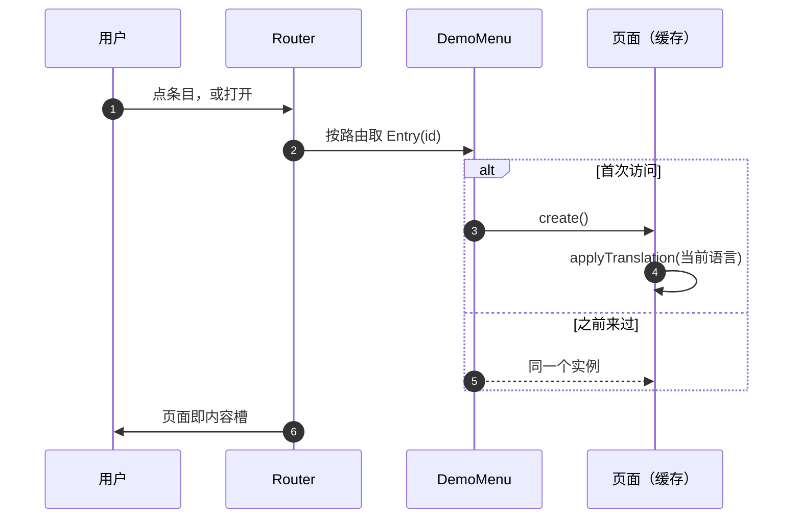

# Demo kit

`ktjs-demo-kit` 是**可运行演示站**的布局 —— 那种既当文档、又当集成测试的站点。它不是 UI 框架，也不是
页面模板：它提供布局（app layout、抽屉、导航栏、菜单）、菜单背后的页面目录、语言与主题状态，以及页面
拼装用的区块。

`ktjs-dom-kit` 的演示就是它的一个实例：你正在读这些代码示例的那些页面，本身就是一个 `DemoMenu` 里的
`Entry`，挂进同一个 `DemoLayout`。

## 坐标

```kotlin
implementation("io.github.shijianjs:ktjs-demo-kit:0.1.0")
```

它以 `api` 依赖带来 `ktjs-dom-kit`、`ktjs-vaadin-web-components`、`ktjs-iconify-icon`（布局由 Vaadin
组件与 Iconify 图标搭成，页面契约用 `HTMLElement` 表述），所以演示项目只加这一行就能开始写页面。

## 它给人什么



| 包 | 提供 |
| --- | --- |
| `…ktjs.demo.layout` | [`DemoLayout`](./pages.md) 与 `LayoutConfig` —— 站点布局及它唯一的配置对象；以及布局与其样式表共用的 `LAYOUT_SHEET`、类名 |
| `…ktjs.demo.nav` | `DemoMenu`、`Group`、`Entry`、`Page`，以及它们背后的 hash `Router` |
| `…ktjs.demo.i18n` | `Lang`（BCP 47 标签，可注册）、`LanguageState`、`Translations<T>` / `texts(…)` 与 `SiteTexts` |
| `…ktjs.demo.page` | [`DemoPage`](./pages.md) 与区块：`paragraph`、`heading`、`anchor`、`codeText`、`bulletList`、`row`、`col`、`exampleBox`、`sectionBlock`、`Readout` |
| `…ktjs.demo.style` | `Theme` / `ThemeMode`（亮色 / 暗色 / 跟随浏览器）、`Palette`（站点上色用的 Lumo 自定义属性）、`RESET`（共享 reset 表） |

## 外壳是三张卡片，不是三个分区

布局不用分割线切窗口。窗口是一块中性的画布（`Palette.page`），三个区域各自是浮在上面的**卡片**：白底、
16px 圆角、只有一层柔和投影（不带边框），离窗口边缘一个 8px 的 gutter，离邻居一个 8px 的 gap。



几何仍然是 app layout 的：导航栏固定、它的实测高度就是内容区的上偏移，抽屉的宽度就是内容区左侧的内缩量，
动的只是*表面*。撑住这个形状的是四条规则，每一条都是因为「显而易见的做法」会坏：

| 规则 | 为什么不能换一种做法 |
| --- | --- |
| gutter 与 gap 是 app layout 各 `::part()` 上的内边距 | 给固定的导航栏加 margin，它落在组件测量的盒子之外，下面的内容就会**压到**导航栏底下；给滚动列唯一的子元素加 margin，它会算进可滚动区域 —— 于是永久多出一条正好这么高的滚动条 |
| 导航栏的 `::part()` 不设 `min-height`，这一行就用控件自己的 44px | 基础样式那个 56px 的最小高度是在条**内部**算的，加上我们自己的 gutter 就变成 56 + 16。改成 gutter 属于这 56：去掉最小高度，整条就是 6 + 44 + 6。这一行不能收到 40 —— 菜单栏按钮在自己的盒子里是 40，带上 margin 是 44，容器矮了就把按钮上下各裁掉 2px |
| 每张卡片自己是滚动视口，每一列是 `overflow: clip` | 卡片若随内容长高，第一次滚动就把自己的上边缘连同圆角滚出视野。而列若留在 `auto`，一旦它认为子元素溢出（典型的是比窗口还长的抽屉目录）就会多画一条滚动条：那是平台那条，方角、不透明，离卡片自己的滚动条只有三像素 |
| 导航栏与两列都是透明的，各自的细线边框被清掉 | app layout 的 Lumo 主题在组件自己那棵树里给它们上色、并把内边距设成 safe-area。组件本来就有的 `--vaadin-app-layout-navbar-*` 自定义属性看似是天然开关，但主题会覆盖它 —— 只有 `::part()` 规则能压过 |

这些 `::part()` 规则也是样式表用 `compound(tag(APP_LAYOUT), pseudo(pseudoElement("part"), ident("navbar")))`
拼选择器、而不是贴字符串的原因：部件名是带类型的值，选择器哪天不再匹配，是构建失败，不是布局错位。

两张会滚动的卡片都换成了自己的细滚动条（`::-webkit-scrollbar`：一条 10px 的轨道，轨道本身什么都不画，
滑块是一枚 4px 的药丸），平台那条经典滚动条 —— 不透明、方角、带箭头 —— 就不会落在任何圆角上。轨道两端
各内缩一个卡片圆角；在 Blink 里，这个 margin 是加在滚动条自己身上的，所以滚到两端时药丸也停在圆角弧之内。

## 接一个站点

演示站的 `main` 永远三步：建状态、定义标签、挂配置。

```kotlin
fun main() {
    val language = LanguageState()          // 内置英语 + 简体中文
    language.init()                         // 把记住的语言写回 <html lang>
    val theme = Theme()                     // 亮 / 暗 / 跟随系统，带持久化
    theme.applyStored()

    // 外壳自己注册；读一次它的标签名，页面上的 <ktjs-demo-layout> 就会被升级。
    val layout = document.getElementById(ElementId("demo")) as? DemoLayout ?: error("no <ktjs-demo-layout>")

    layout.mount(
        LayoutConfig(
            menu = siteMenu(),
            language = language,
            theme = theme,
            texts = siteTexts,
            siteVersion = KIT_VERSION,
            docsUrl = DOCS_URL,
            apiUrl = API_URL,
            sourceUrl = SOURCE_URL,
            logoSrc = "img/ktjs-dom-kit-logo.png",
        ),
    )
}
```

`LayoutConfig` 是**一个**对象，这是有意的。`mount(menu, language, theme, config, texts)` 这样的签名
每加一个旋钮就多一个参数；一个配置对象意味着布局以后多一个关注点（`siteVersion`、反馈链接、base
path）时，各演示项目都不用改调用点。`siteVersion` 之后的都是可选项 —— 只有仓库地址的站点会得到只有一条
条目的链接菜单，一个 URL 都没有的站点则完全隐藏该菜单。

元素本身必须由页面提供（`index.html` 里声明 `<ktjs-demo-layout id="demo">`）；在 `main` 里再建一个布局
只会让声明的那个空着，并给站点整出两个抽屉。

## 语言

kit 自带两种语言，并把「语言」当成**数据**，而不是 enum 分支：

```kotlin
val language = LanguageState(languages = listOf(Langs.EN, Langs.ZH_HANS, Lang("ja")))

private val siteTexts = texts(
    Langs.EN to SiteTexts(siteTitle = "ktjs-dom-kit", …),
    Langs.ZH_HANS to SiteTexts(siteTitle = "ktjs-dom-kit", …),
    Lang("ja") to SiteTexts(siteTitle = "ktjs-dom-kit", …),   // 由应用自己注册
)
```

- `Lang` 是标签之上的 external interface；`Langs` 只放两个内置值，`Lang("ja")` 注册站点有译文的任何
  其他标签。
- `LanguageState` 持有语言列表、当前值、`localStorage` 持久化与 `document.documentElement.lang`；语言菜单
  就是从这份列表建的，所以站点没注册的标签根本不会出现。
- `Translations<T>` 是「一个语言一个文本对象」。缺失的语言回退到**最先声明**的那个 —— 新注册的语言在
  自己的译文到位之前也能显示合理内容。声明顺序就是菜单顺序。
- 切换语言是在已挂载页面上走一遍（`Page.applyTranslation`），绝不重建：滚动位置和用户输入的东西都留着。

## 目录与路由

```kotlin
class Entry(val id: String, val group: Group, val icon: String?, val create: () -> Page)
```

分组由条目推导，所以加一个页面就是加一条 `Entry`，别的都不用动。`id` 就是路由（`#/stylesheets`），也是
`SiteTexts.pageTitles` 的键 —— 表里缺这个 id 时直接显示 id 本身，于是页面能在译文之前先出现在导航里。



页面首次访问时惰性创建，之后缓存，所以页面自己的状态（输入的内容、展开的面板）离开再回来还在。
