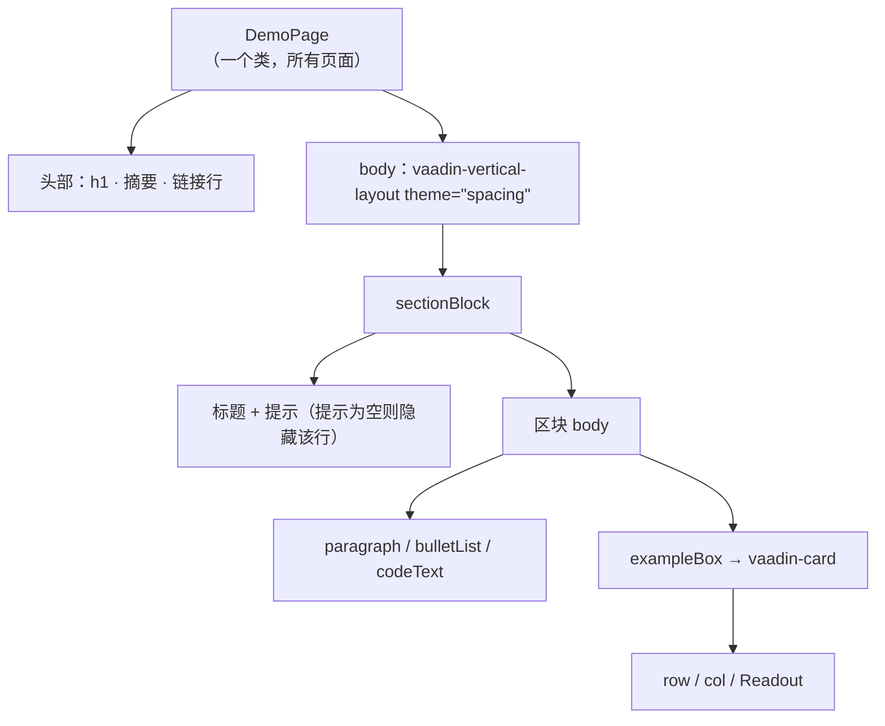

# 页面与区块

演示站的每一页都是同一个框架、填不同的内容：整个站点只有**一个** `DemoPage` 元素类，而不是一页一个类。
九十个页面不需要九十个标签 —— 它们差在内容，不差在外框。

## 页面框架



```kotlin
val page = newPage()
page.setTitle(current.pageTitle)
page.setSummary(current.summary)
page.addLink(anchor("API 参考", apiUrl))     // 摘要下面的链接行
page.body.append(section.root)              // 页面往里填的 body 槽
```

| 成员 | 含义 |
| --- | --- |
| `body` | 页面追加区块的容器 —— 一个带 `theme="spacing"` 的 `vaadin-vertical-layout` |
| `setTitle` / `setSummary` | 页面的 `h1` 与导语段落 |
| `addLink(node)` | 往横向链接行追加；布局由框架负责 |

`body` 是布局组件而不是裸 `div`，只因为一件事：一页会堆好几个 section 区块，而每个区块自己又是纵向
布局。没有间隙地堆盒子，它们就会贴在一起 —— 卡片的底边直接顶到下一个区块的标题。间隙属于容器，所以
页面不必给自己建的每个 section 都加 margin。

`DemoPage` 是**容器**，不是基类：页面创建它、填 `body`、翻译自己的文案。没有东西继承它。

## 区块

区块覆盖文档页真正会说的话：一段正文、一个标题、一段代码、一组列表项、一个示例框、一个有标题的小节。

```kotlin
fun paragraph(text: String = ""): HTMLElement
fun heading(level: Int, text: String = ""): HTMLHeadingElement
fun anchor(text: String, href: String, external: Boolean = false): HTMLAnchorElement
fun codeText(text: String): HTMLElement
fun bulletList(items: List<String>): HTMLElement
fun row(vararg children: Node): HorizontalLayoutElement      // vaadin-horizontal-layout，spacing
fun col(vararg children: Node): VerticalLayoutElement        // vaadin-vertical-layout，spacing
fun exampleBox(caption: String? = null, vararg children: Node): CardElement
fun sectionBlock(): SectionBlock                             // 标题 + 提示 + body
class Readout(initial: String = "")                          // 就地更新的文本
```

这些盒子是 Vaadin 组件 —— `vaadin-vertical-layout`、`vaadin-horizontal-layout`、`vaadin-card` 加上它们的
`padding` / `spacing` 变体 —— 不是手搓 CSS：间隙、内边距、卡片表面归组件库管，站点只写排版和来自
`Palette` 的那几个颜色。一个 section 是三个必须待在一起的节点：

```kotlin
val section = sectionBlock()
section.setText(current.sectionTitle, current.sectionHint)   // 提示为空就隐藏整行
section.body.append(paragraph(current.explanation), exampleBox(current.caption, chip))
page.body.append(section.root)
```

`Readout` 给「要显示自身状态」的示例用：它就地改文本，不重建节点 —— 这也是整个 kit 遵循的同一条规则。

## 文案，以及什么不翻译

每个页面拥有自己的文本类（`OverviewTexts`、`AttributesTexts` ……），并声明一次：

```kotlin
private val texts: Translations<AttributesTexts> = texts(
    Langs.EN to attributesEnglish,
    Langs.ZH_HANS to attributesChinese,
)

override fun applyTranslation(lang: Lang) {
    val current = texts[lang]
    page.setTitle(current.pageTitle)
    section.setText(current.sectionTitle, current.sectionHint)
}
```

`applyTranslation` **就地改写页面持有的节点**，绝不重建树，所以切换语言时滚动位置、用户输入或展开的
面板都留着。来自数据的文本 —— 成员签名、资源路径、代码片段 —— 有意不翻译：那是另一个程序，不是译文。

## 验收页面

演示页就是产品页，所以「能编译」不算验收。要在浏览器里看：shadow 树里的结构、计算样式
（`getComputedStyle`）、`[style]` 节点数量、控制台。dom-kit 的演示用 Playwright 端到端测试做这件事，
并且每页每种主题各截一张图 —— 演示站上的那些图片就是同一次运行产出的。
