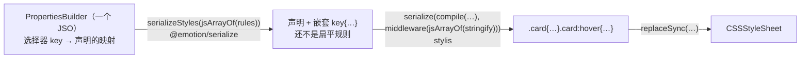
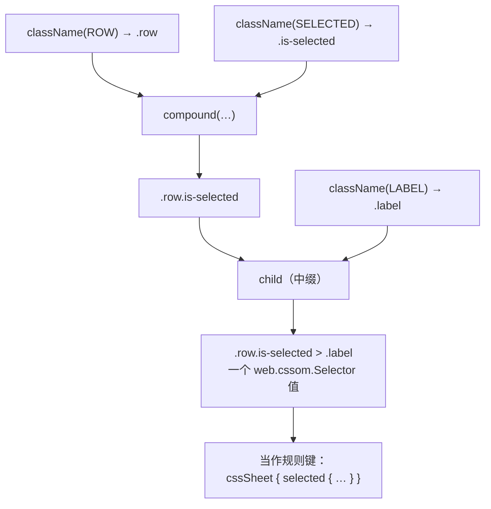

# 类型化样式表

`cssSheet { … }` 从 csstype 的规则对象搭出一份 `CSSStyleSheet`：规则、取值、单位与伪类结构都来自类型，
剩下的字符串只有那些确实没有类型的——自定义属性名、`:nth-child` 公式、`::part(name)` 的标识符。

可运行的对照实验（同一段规则的三种写法 + 一张 adopt 了 sheet 的卡片）在
[ktjs-docusaurus](https://github.com/shijianjs/ktjs-docusaurus) 仓库的 `probes/web-components` 里，入口是
`example.CssSheetExperiment`，在那个 checkout 下跑：

```bash
./gradlew :probes-web-components:jsBrowserDevelopmentRun
```

## 它解决什么

手写 CSS 文本的问题不是长，而是**魔法字符串的范围**：属性名、数值单位、伪类结构都靠人拼，写错只在下一次
肉眼看样式时才发现。

```kotlin
internal val CARD_SHEET: CSSStyleSheet = cssSheet {
    cardClass {                                   // 选择器用 ClassName，见下文
        border = Border(1.px, LineStyle.solid, `var`(cardBorderHook, NamedColor.black))
        transition = many(Transition(PropertyName.borderColor, 0.2.s, TransitionTimingFunction.ease))
        Pseudos.hover { borderColor = `var`(accentHook, `var`(primaryColorHook)) }
    }
}
```

同一段规则手写约 455 个字符的 CSS。上面这种写法里手写的 CSS 文本是 0、cast 是 0，剩下的字符串只有主题的
自定义属性名；伪类变体由 `Pseudos` 给出，一个手写键都没有。

判断值不值得用这套，看的是「还剩多少 CSS 文本要手写」，不是源码行数——一条规则通体都是
`"@media (max-width: 576px)"` 字符串的话，和一份文本文件没有区别。

## 管线与契约




- **顶层是选择器映射**，不是声明集合。`cardClass { … }`、`Pseudos.hover { … }`、`pseudo(Pseudos.host) { … }`、
  `"@media …" { … }` 是 key；写在里面的属性属于最近一层 `{}` 的那条规则。
- `serializeStyles` 的参数是**数组**（emotion 里它是 tagged template 的 `strings`）：
  `serializeStyles([rules])`。传对象本身会去读 `args[0]`，结果是空串。
- 只挂 `stringify`，不挂 `prefixer`：后者会加 `-webkit-` / `-ms-` 前缀，emotion 11 已经不做这件事。
- 版本钉的是 `@emotion/cache` 自己的 pin：`@emotion/serialize` 1.3.3 + `stylis` 4.2.0。
- 序列化在**浏览器侧**发生（`CSSStyleSheet` 在 Node 里不存在），所以带 sheet 的模块只能进浏览器包。

## 写法清单

### 选择器：`ClassName` + `invoke`

`RuleBuilder` 有 `operator fun ClassName.invoke(block)`，点号由它补：

```kotlin
private val cardClass = ClassName("card")   // 也可复用作 element.className

cssSheet { cardClass { … } }
```

坑：`ClassName("card") { … }` **编译不过**——会被解析成「调用工厂 + 尾随 lambda 当第二个实参」。一次性用
可以加括号 `(ClassName("card")) { … }`；要复用就存成 `val` 再 `cardClass { … }`。

伪类、伪元素用本模块自建的 `css/dsl/Pseudos.kt`：它列全 `csstype.SimplePseudosRuleBuilder` 的 64 个选择器，
外加 Web Components 的 `:host`。每个常量**就是伪类/伪元素本身的文本**——`Pseudos.hover` 是 `":hover"`、
`Pseudos.before` 是 `"::before"`：

```kotlin
Pseudos.hover { … }                                  // 和官方 hover { } 一样的写法
pseudos(Pseudos.hover, Pseudos.focusVisible) { … }   // "&:hover,&:focus-visible" 一个块
Pseudos.before { … }
many(Pseudos.hover, Pseudos.focusVisible)             // 也可直接拼成一个 Pseudo
```

短写法来自 `context(builder: RuleBuilder<T>) operator fun Pseudo.invoke(…)`：context 参数自动取
`cssSheet { … }` 作用域里的 `PropertiesBuilder`（Kotlin 2.2+ context parameters，本仓库 2.4 无需开关），
调用点需要 `import io.github.shijianjs.ktjs.dom.css.dsl.invoke`。和官方糖的差别是两点：它把伪类
**挂到当前规则上**（补 `&`，逗号分开的每一支各自补，否则 stylis 会把后面几支当成子元素），以及能组合。
`many(…)` 的结果也是 `Pseudo`，可以直接 `(many(Pseudos.hover, Pseudos.focusVisible)) { … }`——括号不能省
（`many` 是 `vararg`，不加括号尾随 lambda 会被当成 vararg 实参），所以组合态更推荐 `pseudos(…)`。
显式的 `pseudo(value) { … }` 仍在，适合拿到一个 `Pseudo` 变量时用。

冒号属于值本身，类别在造值时就定死：`pseudoClass("hover")` 是 `:hover`，`pseudoElement("before")` 是
`::before`。调用点没有 `element = true` 这种开关，因为 CSS 里同一个名字不可能既是类又是元素。`&` 也不在
值里——它说的是「挂到哪儿」，只有把它写进规则的作用域才补。所以同一个 `Pseudos.hover` 既能当状态调用
（`&:hover`），也能当选择器零件用：`compound(className(ROW), pseudo(Pseudos.firstChild))` 就是
`.row:first-child`。

**at-rule 有官方入口，不要手写 `"@media …"` / `"@supports …"` 字符串**：

```kotlin
`@media`(MediaType.screen and maxWidth(576.px)) { … }   // csstype.RuleBuilder.@media

// SupportsQuery 仿 web.cssom.MediaQuery：声明两侧都类型化，and/or/not 组合
supports(
    supportsDeclaration(webkitBackgroundClipName, BackgroundClip.text) or
        supportsDeclaration(PropertyName.backgroundClip, BackgroundClip.text),
) { … }
```

官方已经给的（IDE 里查符号时优先找这些，别再自己拼）：

| 入口 | 在哪 | 用途 |
| --- | --- | --- |
| `RuleBuilder.@media / @container / @font-face / @view-transition` | `kotlin-csstype/.../RuleBuilder.kt` | at-rule 块，`@media(query)` 收 `MediaQuery` |
| `AtRules.media / supports / layer / page / scope / …` | `web.cssom.AtRules` | 所有 at-rule 关键字常量（`@JsValue("@media")` 等） |
| `MediaQuery.and / or / not` | `web.cssom.MediaQuery.kt` | 组合条件 |
| `Selector("…")`、`Selector.invoke { … }` | `web.cssom.Selector.kt`、`RuleBuilder.kt` | 选择器当值用；它本身就是规则键的类型，中间不用转换 |
| `MediaType.screen / print / all` | `web.cssom.atrule.MediaType` | 媒体类型 |
| `maxWidth / minWidth / width / height / orientation / prefersColorScheme / prefersReducedMotion / …` | `web.cssom.atrule/*.fun.kt` | 媒体特性（一整个目录，约 30 个） |
| `var / env / rgb / many / array / important / linearGradient / stop / Content() / NamedColor / PropertyName / translatex` | `web.cssom` 的 `*.functions.kt`、`*.ext.kt`、`*.fun.kt` | 取值与函数 |

**目前确实还是字符串的**：应用级自定义属性名（`CustomPropertyName("--brand")`），以及 CSS 本身就没有类型的裸
token——`An+B` 公式、`::part` 的名字、语言标签，它们走各自类型的工厂（`ident("2n+1")`）。选择器本身不再是
字符串：`*`、`&` 是 `Selectors` 的常量，`:host` / `:root` / `:scope` 是 `Pseudos` 的常量（它们本来就是伪类，
所以同一个值也能当 `pseudo(…)` 的实参），HTML 属性名则全在 `web.cssom.HtmlAttributes` 里。

### 拼接选择器：`compound` + 组合器

`css/dsl/Composition.kt` 是一个选择器表达式引擎：每种节点一个工厂，组合器是 infix 函数，产出的是
`web.cssom.Selector`——cssom 自己的那个不透明选择器，也正是 `csstype.RuleBuilder` 用来当规则键的类型。
它是个值：能存字段、能传函数，最后直接当规则键，中间不需要任何转换。

```kotlin
private val ROW = ClassName("row")
private val SELECTED = ClassName("is-selected")
private val BUTTON: TagName<HTMLButtonElement> = TagName("vaadin-button")

val selected = compound(className(ROW), className(SELECTED))         // .row.is-selected
val cell = className(ROW) child className(CLASS_LABEL)               // .row > .label
val hostDisabled = pseudo(Pseudos.host, attributeSelector(HtmlAttributes.disabled)) child tag(BUTTON)
                                                                     // :host([disabled]) > vaadin-button

cssSheet { selected { display = Display.block } }
```

`compound` 与各个组合器拼出来的是一棵树，结果是一个选择器**值**，不是文本：



| 节点类型 | 工厂 |
| --- | --- |
| 类型选择器 | `tag(HtmlTagName.div)` / `tag(BUTTON)`——收 `TagName`，不收字符串 |
| class、id | `className(ClassName("x"))`、`id("main")` |
| 属性 | `attributeSelector(HtmlAttributes.disabled)` / `attributeSelector(HtmlAttributes.type, "text")`——走生成的属性目录；字符串形式只留给目录外的名字（`aria-current`、`data-*`） |
| 伪类、伪元素 | `pseudo(Pseudos.hover)`、`pseudo(Pseudos.before)`、`pseudo(pseudoElement("part"), ident("label"))`、`pseudo(pseudoClass("not"), className(HIDDEN))` |
| `*`、`&` | `Selectors.universal`、`Selectors.nesting` |
| 复合（同一个元素） | `compound(vararg parts)` |
| 组合器 | `descendant`、`child`、`nextSibling`、`subsequentSibling`、`column`（infix） |
| 选择器列表 | `selectorList(vararg selectors)`，逗号连接 |

**属性名从目录里取。** `web.cssom.HtmlAttributes` 是 210 个常量的 sealed interface，每个常量装的就是带方括号的
选择器片段（`HtmlAttributes.type` 是 `"[type]"`），它没有构造函数——所以 `attributeSelector(…)` 收常量而不收名字。
有值时值当第二个实参（`attributeSelector(HtmlAttributes.type, "text")` → `[type="text"]`），仍留在字符串形式的
只有目录外的名字（ARIA、`data-*`、项目自造的）。`tag(…)` 与 `className(…)` 也只收 `TagName` / `ClassName`，
新名字一律在声明处写成 `val`。

`Pseudos` 里的变体**本身就是它看起来的那个选择器零件**——`Pseudo` 只装 `:hover` 这样的文本，`&` 属于挂载它的
作用域。所以同一个常量既能当外层规则的状态（`Pseudos.hover { … }` → `&:hover`），也能当一个独立选择器的零件
（`compound(className(ROW), pseudo(Pseudos.firstChild))` → `.row:first-child`）。裸的 `:host` 规则键写
`pseudo(Pseudos.host)`：写成 `Pseudos.host { … }` 会补上 `&` 得到 `&:host`，永远匹配不到。

引擎刻意不做的三件事：

- **不解析**。`Selector(text)` 只接收交给它的那一段文本，给 CSS 没有类型的地方用；它不是「粘贴整条选择器」
  的入口——那条字符串正是这套 API 要替代的东西。
- **不转义标识符**。class 名里带空格或引号是调用点的 bug，不靠静默转义掩盖。
- **渲染后不再重排**。组合器按 CSS 的写法带空格（`.row > .label`），stylis 在样式表里会压成 `.row>.label`，
  所以断言文本要比对样式表产物，而不是比选择器。

`vararg` 工厂（`compound(…)`、`selectorList(…)`）不能直接接尾随块：lambda 会被当成多一个实参。先把值命名
（`val selected = compound(…)` 再 `selected { … }`），或者加括号——和 `many(…)` 是同一个坑。

### 自定义属性：具名常量 + `var(name, fallback)`

```kotlin
private val accentHook = CustomPropertyName<Color>("--ktjs-accent")
private val shadowHook = CustomPropertyName<BoxShadow>("--ktjs-shadow")

color = var(accentHook, NamedColor.white)                       // var(--ktjs-accent,#FFFFFF)
boxShadow = var(shadowHook, BoxShadow(0.px, 10.px, 24.px, …))
```

类型参数是 hook 承载的值类型，`var` 的兜底值因此也必须同类型——兜底值是**类型化的值**，不是文本。
cssom 没有应用级属性名的常量，字符串在这里出现一次；具名常量避免它散落多处。

### 命名色、多值、过渡

| 需要 | 写法 |
| --- | --- |
| 命名色 | `NamedColor.white`（`@JsValue("#FFFFFF")`，类型就是 `Color`） |
| 任意色 | `rgb(127, 127, 127, 0.24)`、`oklch(…)`、`Color("var(--x)")`（最后手段） |
| 逗号多值 | `many(a, b)`；空格多值 `array(…)`；`!important` 用 `important(x)` |
| 过渡 | `Transition(PropertyName.borderColor, 0.2.s, TransitionTimingFunction.ease)`，多个用 `many(…)` |
| 回退阶梯 | `fallback(Display.grid, Display.flex)`（序列化成两条同名声明） |
| 阴影/边框/内边距 | `BoxShadow(0.px, 10.px, 24.px, rgb(…))`、`Border(1.px, LineStyle.solid, …)`、`Padding(…)` |

`PropertyName.borderColor` 能当过渡属性名，是因为 `PropertyName<T> : Ident`，而 `IdentType` 里包含
`TransitionProperty`——所以 `TransitionProperty` 只暴露 `all` 并不妨碍使用，**不需要 cast**。

### cssom 没覆盖的部分：在 `io.github.shijianjs.ktjs.dom.css.dsl` 里补

不要因为「cssom 没有」就把整条规则退回文本，也不要让 `unsafeCast` 散到调用点。缺什么就在本模块的
`css.dsl` 包里按官方风格（`unsafeCast` 拼一次、值仍然类型化）补一个，调用点照常写类型：

| 缺的东西 | 补在哪 | 调用点形态 |
| --- | --- | --- |
| `radial-gradient(…)` | `css/dsl/Gradients.kt` | `radialGradient(RadialGradientShape.Circle, colorStop(glow), stop(Color.transparent, 70.pct))` |
| 无位置的颜色停靠点 | `css/dsl/Gradients.kt` | `colorStop(color)`——cssom 的 `stop` 总要带位置 |
| `-webkit-background-clip`（属性 + 名字） | `css/dsl/VendorProperties.kt` | `webkitBackgroundClip(BackgroundClip.text)`、`webkitBackgroundClipName` 给 supports 条件用 |
| `@supports` 条件类型 | `css/dsl/Supports.kt` | `SupportsQuery` + `supportsDeclaration(PropertyName<T>, T)` + `and/or/not`，照 `web.cssom.MediaQuery` 的形态 |
| `@supports` 块（唯一缺的 at-rule helper） | `css/dsl/AtRules.kt` | `supports(query) { … }`，关键字取 `AtRules.supports` |
| 伪类/伪元素常量 + 组合态 | `css/dsl/Pseudos.kt` | `Pseudos.hover` / `pseudo(…)` / `pseudos(…)`（64 个常量） |
| 用零件拼选择器 | `css/dsl/Composition.kt` | `compound(…)`、`selectorList(…)`、`className` / `tag` / `attributeSelector` / `pseudo`、各个组合器 |

有两处 cssom **其实已经覆盖**，不要再自造：`pointer-events: none` 一度在这里当过常量，但 cssom 生成的是
`web.cssom.None.none`（`None : NoneType`，而 `NoneType` 是 `PointerEvents` 的父类型，直接赋给属性即可）。
先搜符号再补常量——这条就是下面「找不到类先怀疑自己」的另一面。

补的规矩：**值仍然类型化**（枚举、工具类型、`Length`），只有「属性名」这种没法类型化的东西才写成字符串；
一个缺口一个函数或常量，不要提供 `putRaw(name, value)` 这类通用逃生口——那等于把字符串又请回来。

## 坑

### 伪类糖缺 `&`，而且表达不了组合态

`SimplePseudosRuleBuilder.hover` / `before` / `after` 写出的 key 是 `":hover"`、`"::before"`，没有 `&`。
stylis 会把它当成**后代**选择器：

```
hover {}      -> .probe-sugar :hover{…}     ← 不是 .probe-sugar:hover
"&:hover" {}  -> .probe-ampersand:hover{…}
```

根因在 kotlin-wrappers 的生成器：`karakum/csstype/Pseudos.kt` 的 `convertSimplePseudo` 把 csstype TS
联合里的字符串原样写进方法体，而同一套 API 里手写的 `RuleBuilder.and` 会加 `&`、`kotlin-css` 的
`CssBuilder.hover` 也一直写 `"&:hover"`。已报
[kotlin-wrappers#2933](https://github.com/JetBrains/kotlin-wrappers/issues/2933)。

**但不必等它修**：这个糖是「一个方法一个伪类」，就算补上 `&` 也写不出
`"&:hover,&:focus-visible"` 这种「多个状态共用一个块」的形式（本站的 `KtjsStep`、`KtjsAction` 都要）。
所以 `css/dsl/Pseudos.kt` 自建一层，形态照 `web.dom.TagName` + `web.html.HtmlTagName`：

- `external interface Pseudo` + `pseudoClass(name)` / `pseudoElement(name)` 两个工厂——冒号和类别在造值时定死，
  `Pseudo` 装的正好是 CSS 打印出来的那一段文本；
- `object Pseudos` 列全 `SimplePseudosRuleBuilder` 的 64 个字符串（外加 `:host`），每个常量就是伪类本身
  （`Pseudos.hover` = `":hover"`、`Pseudos.before` = `"::before"`）；
- `pseudo(pseudo)` / `pseudo(pseudo, argument)` 把 `Pseudo` 变成选择器零件；
- `context(RuleBuilder<T>) operator fun Pseudo.invoke(block)`——于是 `Pseudos.hover { … }` 的写法和官方
  `hover { … }` 一样；`&` 是在这里由作用域补的，逗号分开的每一支各自补；
- `RuleBuilder.pseudo(pseudo, block)`（显式形式）与 `RuleBuilder.pseudos(vararg pseudos, block)`
  （后者用 `web.cssom.many` 把多个 `Selector` 拼成一条）；`many` 也可以直接拼多个 `Pseudo`；
- 列表外的伪类/伪元素用 `pseudoClass("not")` + 实参选择器、`pseudoElement("part")` + 名字——自由的是
  **实参**，不是类别。

### 不要用 CSSOM 逐条 `insertRule` 代替序列化

那条路（`insertRule(".x {}")` + `rule.style` 赋值）也能拿到类型检查，但 CSSOM 对**同一规则里同一属性
只保留最后一个声明**：`fallback(a, b)` 阶梯会只剩最后一条。文本路径能保留阶梯，由浏览器解析时取舍。

### 产物与手写文本不是逐字相同

比对时先归一化，别断言整串：`#fff` → `#FFFFFF`、`0` → `0px`、逗号后可能没有空格、
`-webkit-background-clip` 与 `background-clip` 在 Chrome 里是同一属性的别名，文本里两条都在、从 CSSOM
读回来只剩一条、`transition: border-color 0.2s ease` 里的 `ease` 在 CSSOM 回读时会消失（文本路径不会）。
等价即可；要断言就断语义片段（见本模块 `jsTest` 里的 `CssSheetTest`）。

### 一份 sheet 服务所有实例

`cssSheet` 返回的 `CSSStyleSheet` 放进**组件类的 companion**，所有实例 `attachStyledShadow(HOME_RESET, SHEET)`。
不要在构造函数里现建：规则是静态的，一份就够。

## 本站的落地

首页元素都是这样写的：

| 文件 | 内容 |
| --- | --- |
| `HomeReset.kt` | 共享的那份 sheet：`*` / `*::before` / `*::after` / `:host` |
| `KtjsFeature.kt`、`KtjsStep.kt` | 卡片表面，外加 `&:hover` / `&:focus-visible` |
| `KtjsAction.kt` | `:host > a` 与两个 pill 类及其悬停态 |
| `KtjsHero.kt` | 伪元素光斑、`@supports` 渐变字与一个 `@media` 块（用到 `css` 包的 `radialGradient` / `webkitBackgroundClip`） |

迁移一个组件时的步骤：先把内联表达不了的那几条规则搬进 `cssSheet { }`，跑一次 `jsBrowserTest`，再把 sheet
读出来（`element.shadowRoot.adoptedStyleSheets`）与原来的文本做语义比对（注意上面那条归一化差异），确认
等价后删掉文本。

## 参考

- csstype 规则 DSL：`kotlin-csstype/src/webMain/kotlin/csstype/RuleBuilder.kt`（`Selector`/`ClassName`/`and`）、
  `.../generated/csstype/Simple*Pseudo*RuleBuilder.kt`（伪类糖，注意上面那条坑）
- cssom 取值类型：`kotlin-cssom-core/src/webMain/generated/web/cssom/`（`*Property.kt` 的类型、
  `*.functions.kt` 的工厂：`Border`、`BoxShadow`、`Transition`、`Gradient`、`Color`、`NamedColor`）
- cssom 手写辅助：`Reference.functions.kt`（`var`/`env`）、`many.kt`、`array.kt`、`important.kt`
- 序列化：`@emotion/serialize` 的 `serializeStyles`，`stylis` 的 `compile`/`serialize`/`middleware`/`stringify`
- 对照实验与结论：**ktjs-docusaurus** 仓库的 `probes/web-components`（`CssSheetExperiment`）
