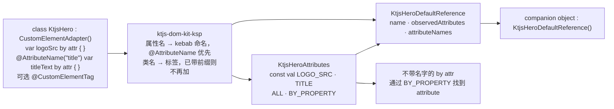

# 自定义元素

一个组件就是一个继承 `CustomElementAdapter` 的 Kotlin 类，用 [`attr`](./attributes.md) 声明它的属性，再继承
`ktjs-dom-kit-ksp` 为它生成的 reference。没有 JS 类字面量，没有组件库，也不需要给生命周期钩子起别名。

```kotlin
class KtjsBadge : CustomElementAdapter() {

    private val anchor = TagName<HTMLAnchorElement>("a").createElement()

    var href: String by attr { change -> anchor.href = change.newValue }

    init {
        // 构造函数里可以挂 shadow root；但不能往元素自己身上加子节点
        attachShadowRoot().append(anchor)
    }

    override fun connectedCallback() {
        applyInitialAttributes()
    }

    companion object : KtjsBadgeDefaultReference()
}

val badge: KtjsBadge = KtjsBadge.NAME { href = "docs/intro" }
```

这个文件里没有一个字面量说标签是什么、观察哪些 attribute：`KtjsBadgeDefaultReference` 就是类名接在配置
好的前缀后面，观察全部 `by attr` 属性。细节见[处理器生成了什么](#处理器生成了什么)。

## 基类做了什么

`CustomElementAdapter : HTMLElement()` 接过了每个组件否则都要重复的三件事：

1. **生命周期钩子**，按原生名字声明成可 override 的方法：`connectedCallback`、
   `connectedMoveCallback`、`disconnectedCallback`、`adoptedCallback`、`attributeChangedCallback`。
   元素类写一句 `override fun connectedCallback()`，浏览器就会调用它。
2. **子类的 `attr` 委托**。每个属性初始化时把自己的委托注册到元素上，之后浏览器同步的
   `attributeChangedCallback` 把**已注册**属性的每次变化转给同名委托，所以属性与 attribute 不可能对不上
   ——连一个微任务的时间差都没有。详见[属性](./attributes.md)。
3. **删桥**，即下面的 `stripBridgesFrom`。

## `observedAttributes` 就是契约

`attributeChangedCallback` 是平台自己的钩子，只为类里静态 `observedAttributes` 列出的属性触发。这份名单由
`customElements.define` 读一次，所以它必须在 companion 的 `init` 定义标签**之前**就存在——比任何实例早，
更比任何委托早。而那一刻 Kotlin 侧没有任何东西能回答这个问题：委托是构造函数里按实例创建的，Kotlin/JS
的类也没有静态初始化块可以看见自己的属性。编译器能，所以这份名单是生成出来的，不是手写的。

另一种写法——在声明旁手写一个数组——只是把 `by attr` 已经说过的话再说一遍，而且漏写一个名字不是响亮的
失败：property 照样读得到 attribute，初始值照样会到（升级回调或 `applyInitialAttributes()`），但**之后**对
这个 attribute 的外部写入没人上报。手写 reference 时仍有两道防护：

- `applyInitialAttributes()` 是元素连上后的兜底，漏写的名字至少还能报出它创建时带的那份标记。
- 本仓库浏览器测试里的 `AttributeProbe` 拿生成出来的数组和属性实际注册的名字对齐，处理器漏掉一个名字会
  挂构建，而不是悄悄失效。

## 处理器生成了什么

`ktjs-dom-kit-ksp` 读类声明，在元素旁边写两样东西：名字，以及 companion 要继承的那个 reference。



那个 object 装着运行时需要的常量与两张表：

```kotlin
internal object KtjsHeroAttributes {
    const val LOGO_SRC: String = "logo-src"
    const val TITLE: String = "title"
    val ALL: Array<String> = arrayOf(LOGO_SRC, TITLE)
    val BY_PROPERTY: Map<String, String> = mapOf("logoSrc" to LOGO_SRC, "titleText" to TITLE)
}
```

`ALL` 是浏览器当作 `observedAttributes` 读进去的那份。`BY_PROPERTY` 解决另一半问题：委托属性在运行时看不见
自己的类，只看得见名字，所以 `by attr` 需要一张表才知道 `titleText` 代表的是 `title`。reference 在
`customElements.define` 时就把这张表注册好——早于任何实例，之后创建的每个委托都能读到它。

reference 把每个参数都填好，所以 companion 只剩一行：

```kotlin
internal open class KtjsHeroDefaultReference(
    name: String = "ktjs-hero",
    formAssociated: Boolean? = null,
    observedAttributes: ReadonlyArray<JsString>? = KtjsHeroAttributes.ALL,
    register: Boolean = true,
    attributeNames: Map<String, String>? = KtjsHeroAttributes.BY_PROPERTY,
) : CustomElementReferenceAdapter<KtjsHero>(…)
```

它的参数是有意留出来的：标签晚点才定义就传 `register = false`（测试里的
`UpgradeProbeDefaultReference(register = false)`），想换标签就传 `name = …`。

元素这边既不写 attribute 名，也不写 reference：

```kotlin
class KtjsHero : CustomElementAdapter() {
    var logoSrc: String by attr { … }

    @AttributeName("title")                                     // attribute 名不是 title-text
    var titleText: String by attr { … }

    companion object : KtjsHeroDefaultReference()
}
```

生成规则：

- **attribute 名**是属性名的 kebab 形式（`logoSrc` → `logo-src`，`maxCount` → `max-count`），除非
  `@AttributeName` 另说。哪些属性算 attribute 由 `isDelegated()` 判定：适配器里的委托属性只有 `attr` 一种。
  两个属性映射到同一个 attribute 会报编译错误。
- **标签**是类名的 kebab 形式；只有当它本身不是以 `ktjs.tagPrefix`（默认 `ktjs-`）开头时，才把前缀加在前面。
  两族的类名本来就带自己的标记，所以 `KtjsHero` 是 `ktjs-hero`——不是 `ktjs-ktjs-hero`——而 `demo-` 模块里的
  `StepBadge` 是 `demo-step-badge`。全局配置写在模块里一次：

  ```kotlin
  ksp { arg("ktjs.tagPrefix", "demo-") }        // StepBadge → demo-step-badge

  @CustomElementTag("ktjs-hero")                // 只有这一个类不合默认规则
  class KtjsHero : CustomElementAdapter() { … }
  ```
- **可见性跟随元素类**：`internal` 的元素得到 `internal` 的声明，因为 public 的 companion 无法继承
  `internal` 的父类。

接入只有两行，写在元素自己所在的模块里：

```kotlin
plugins { id("com.google.devtools.ksp") }

dependencies { add("kspJs", project(":ktjs-dom-kit-ksp")) }
```

本仓库浏览器测试里的 `AttributeProbe` 与 `UpgradeProbe` 就是参考接线：处理器跑在 `jsTest` 上，两者都带
`@CustomElementTag`（它们的标签是 `ktjs-attr-probe` 与 `ktjs-attr-upgrade-probe`，不是类名），
`theGeneratedListMatchesTheDeclarations` 拿 `ALL` 和属性实际注册的名字比对。`demo` 模块则是应用形态的同款
接线：`ktjs.tagPrefix = "demo-"`、九个元素、全仓没有一个标签字面量，`GeneratedReferenceTest` 从外部往这些
元素上写 attribute，再读它们重绘后的 shadow。

除此之外不再生成东西：没跑处理器的模块照样能编译，因为 `CustomElementReferenceAdapter` 本身是公开的，
同样的参数手写也能给——那是兜底，不是推荐路径。

## 官方 `CustomElement` 接口

基类声明是 `CustomElementAdapter : HTMLElement(), CustomElement.WithCallbacks`。把钩子写成 `override fun`
才能让这个接口真正生效：`web.components.CustomElement` 把钩子声明成 `val`，Kotlin 会把
`override val connectedCallback` 编译成 **getter**，而浏览器只认方法——元素照样渲染，回调却静默不执行。
`CustomElement.WithCallbacks` 是把它们声明成函数的那个变体，所以在基类里 override
`connectedCallback` 一次，就是浏览器会调用的那个方法，不必给每个元素起 `onConnected` 之类别名。

## 自递归桥

Kotlin/JS 会为类继承的每一个外部 DOM 成员（`ParentNode`、`ChildNode`、`Animatable`、`HTMLOrSVGElement`、
`EventTargetLike`……）生成一个转发成员，而这个成员调用它自己：

```js
querySelector(selectors) { return this.querySelector(selectors); }
```

`connectedCallback` 里第一句走到这些名字——`querySelector`、`querySelectorAll`、`append`、`animate`、
`focus`、`addEventListener`……——就会递归到栈溢出。`getAttribute` / `setAttribute` / `hasAttribute` /
`textContent` 不需要处理：它们是外部 `Element` 类的抽象成员，根本不会生成桥。

wrapper 侧报在 [kotlin-wrappers#2932](https://github.com/JetBrains/kotlin-wrappers/issues/2932)，
编译器侧是 [KT-91505](https://youtrack.jetbrains.com/issue/KT-91505)：桥是为在外部**接口**上声明为
`= definedExternally` 的成员生成的（外部**类**的成员如 `getAttribute` 是抽象的，在 `ABSTRACT` 判断处就
返回了），桥的名字与它自己的目标同名，于是里面的调用解析回它自己。JVM 后端对这个模式有防护
（`isErroneousSpecialBridge`，KT-82651），JS 后端在 Kotlin **2.5.20-Beta1**（构建 `2.5.20-dev-4666`）
拿到了同样的防护。本仓库编译用的 2.4.21 正是受影响版本之一（另两个是 2.2.20 与 2.5.0-RC），所以这个
绕法还得留着。升级工具链后编译器不再生成这些桥，删除变成空操作，那时可以把 `stripBridgesFrom` 连同
`defineIfMissing` 里对它的调用和这个公开 API 一起撤掉，元素类的代码不用改。

`stripBridgesFrom(klass)` 从类的原型链上一层层删掉这些名字，删到 `HTMLElement.prototype` 之前为止——那里
才是真正的 DOM 方法。删一个本来就没被桥接的名字是空操作，所以名单可以比某个类实际需要的更宽。它刻意走完整
条链：Kotlin 给**每一层**类都生成桥，只清 `CustomElementAdapter` 会留下元素类自己的那一份。

之后原生写法直接可用——`querySelectorAll(...)`、`append(...)`、`animate(...)`——不需要 `…Super` 转发。
（override 成员上也不允许写 `@JsName` 别名。）

## 定义标签

```kotlin
companion object : CustomElementReferenceAdapter<KtjsBadge>(KtjsBadge::class.js, "ktjs-badge")
```

`CustomElementReferenceAdapter<T>(clazz, name, formAssociated, observedAttributes, register)` 继承浏览器要的
`web.components.CustomElementReference`——原来的三个构造参数原样透传——再补上元素需要的两件东西：`NAME`
（带类型的 `TagName<T>`），以及 `init` 里的注册（除非构造时传 `register = false`，否则调用
`defineIfMissing(NAME, this)`）。

`defineIfMissing(tag, reference)` 先跑 `stripBridgesFrom`，再 `customElements.define`，标签已注册时直接
返回。顺序是有原因的，也是它比直接调 `customElements.define` 更该用的理由：定义标签会升级文档里已经存在
的同类元素，它们的 `connectedCallback` 立即执行——如果那时桥还在，就是一次栈溢出。重复调用是安全的，这才
让它可以放在可能被求值多次的模块里。

注册发生在 companion 的 `init`，所以 **读一次 `NAME` 就是全部协议**：它完成注册（顺带升级文档里已经写好
的标签）并创建元素；`NAME { … }` 的 lambda 接收者是元素本身，元素自己的方法直接在作用域里。

```mermaid
flowchart TB
  D["companion object : CustomElementReferenceAdapter(X::class.js, \"tag\")"] --> I["init { if (register) defineIfMissing(NAME, this) }"]
  I --> S["stripBridgesFrom(klass)<br/>沿原型链逐层删掉转发桥，<br/>删到 HTMLElement.prototype 之前为止"]
  S --> R["customElements.define(tag, companion)"]
  R --> U["文档里已有的同类元素立即升级"]
  U --> AC["attributeChangedCallback<br/>标记带的每个已观察属性各一次"]
  AC --> C["connectedCallback<br/>shadow 子树在构造函数里就已建好"]
  C --> A["applyInitialAttributes()<br/>写默认值，兼一次幂等兜底"]
  N["X.NAME { … }"] --> R
```


| 部件 | 来自 |
| --- | --- |
| `CustomElementReferenceAdapter<T>(T::class.js, "tag")` | `ktjs-dom-kit`；包住 `web.components.CustomElementReference`，在 `init` 里注册 |
| `NAME: TagName<T>` | 适配器；标签名每个元素只写一处，读它就是注册 + 创建 |
| `defineIfMissing` | `ktjs-dom-kit`；适配器内部调用它，只有 `register = false` 的标签才需要手动调用 |

## 创建元素

`TagName<T>.createElement { … }` 包装了类型化的 `document.createElement(TagName<T>)`：标签名决定属性类型，
回调不需要 cast 就能拿到：

```kotlin
val action = KtjsAction.NAME.createElement {
    kind = ActionKind.Primary      // MDX 里写 kind="primary"，落到同一个属性
    href = "docs/intro"
    textContent = "Get started"
}
```

## 构造函数的规矩

自定义元素规范禁止构造函数往元素自己身上加 attribute 或子节点。`attachShadow()` 是明确允许的，所以组件把
子树建进 shadow root：

```kotlin
class KtjsBadge : CustomElementAdapter() {
    init {
        attachShadowRoot().append(anchor)      // 可以：shadow root 不是元素本身
        // this.setAttribute("…", "…")         // createElement 时抛 NotSupportedError
        // this.append(anchor)                 // 同样
    }
}
```

两个连带结论值得记住：

- **不要在构造函数里给元素自己设属性。** 构造完就带属性时 `document.createElement("ktjs-badge")` 会抛
  `NotSupportedError`（解析器和升级路径不会）。元素永远需要的样式因此写成自己 sheet 里的 `:host` 规则，
  而不是 `style` 属性。
- **监听器跟着归属走。** 挂在组件自有节点上的监听器写在构造函数里，不需要清理；挂在 `document`、
  `window`、`matchMedia` 上的必须写在 `disconnectedCallback` 里并用标志位保证幂等——元素移动会再触发一次
  `connectedCallback`。
