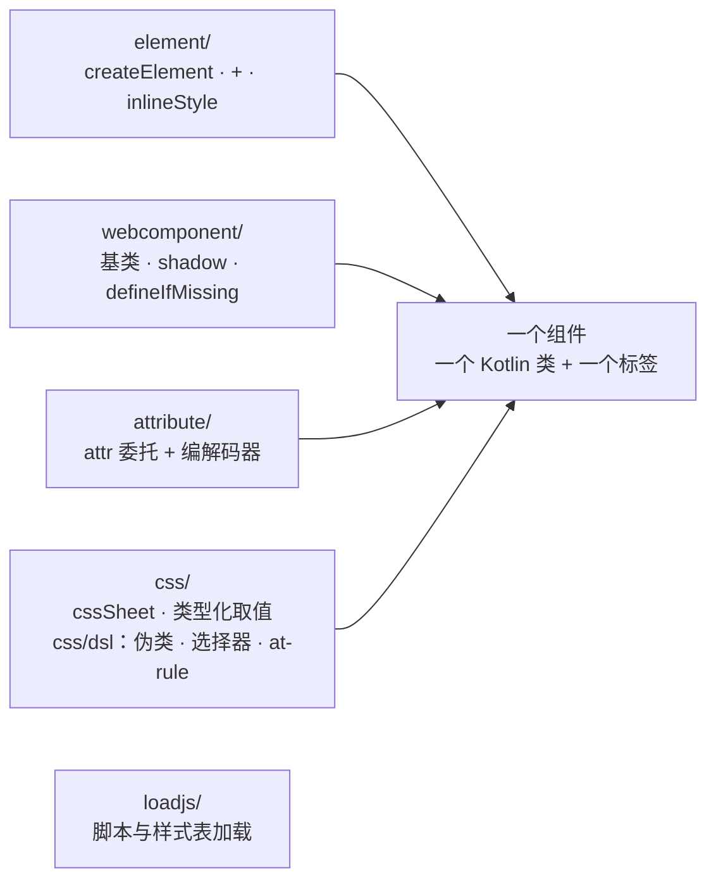
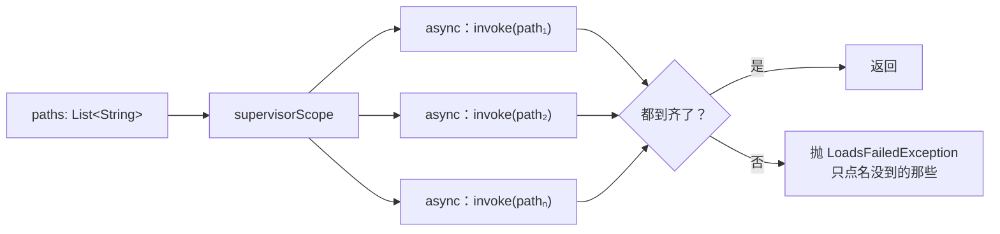
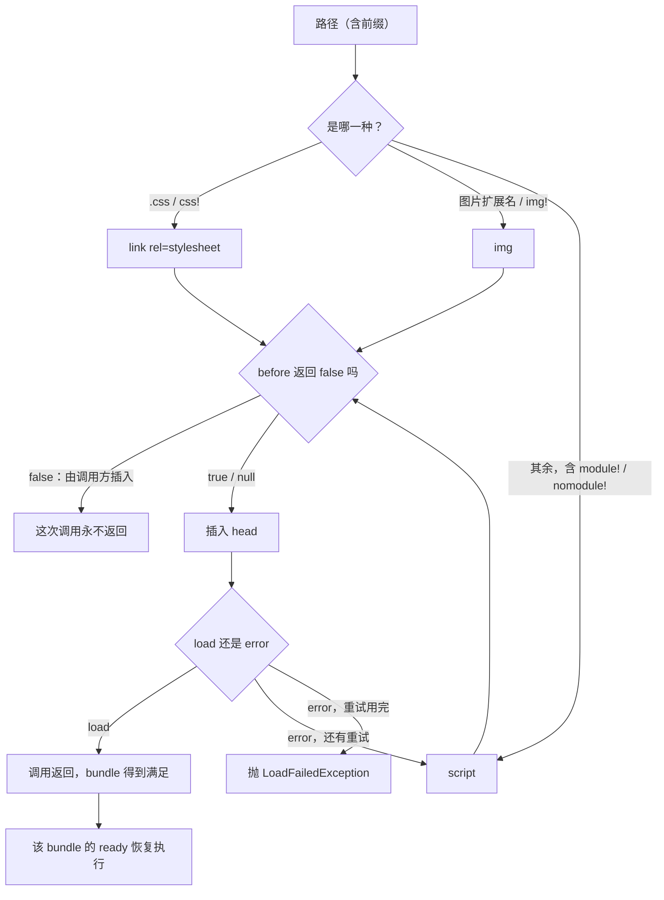

# DOM 工具箱

`ktjs-dom-kit` 是一个发布出去的工具库：用 Kotlin/JS 对着原生 DOM 写组件时用的辅助代码，不认识任何文档
框架，背后也没有任何组件运行时。

它是「不用 UI 框架写 UI」时踩的那层地皮——自定义元素可以继承的基类、把 DOM 当作唯一状态来源的属性委托、
元素内联样式的类型化视图、用 Kotlin 值（而不是 CSS 文本）搭出 `CSSStyleSheet` 的方式，以及从 `loadjs`
翻译过来的脚本 / 样式表 / 图片加载器。

## 谁在用它

[ktjs-docusaurus](https://github.com/shijianjs/ktjs-docusaurus) 的站点就建在它上面：那个首页上的每个
`<ktjs-…>` 元素都继承 `CustomElementAdapter`、用 `cssSheet { … }` 写自己的样式。那是消费方，不是上级——
构件由这个仓库发布，站点像任何普通项目一样依赖它。

## 为什么单独一个仓库

这里没有任何 npm 包要跟随，所以版本是手写的语义版本（`0.2.0`），不走本仓库里 npm 封装模块那套
`{npm 版本}-kt.{修订号}`。剩下唯一的 npm 依赖图是 emotion 的序列化器——`cssSheet { … }` 用它产出 CSS 文本。

这个仓库刻意不做「一库一项目」：一个 API 只有十几个声明的封装，不值得为它单独开仓库、CI、发布流程和
Pages 站点，所以小库作为额外的 Gradle 模块落在这里，并在本站拿到自己的一节文档。构建会自动收集每个
`ktjs-*` 模块：发布、Dokka 与版本报表都不用改。

## 坐标

```kotlin
implementation("io.github.shijianjs:ktjs-dom-kit:0.2.0")
```

构件发布到 Maven Central，API 参考在本站 `/api/` 下。

## 里面有什么

模块按关注点分包：一件事一个包；只要一个包里存在明确的父子级或一对多关系，就再下沉一层子包（一个类型与
它的各种实现、一张样式表与写它时用的语法糖）；一个声明一个文件，没有哪个文件是杂物间。




| 包 | 提供 |
| --- | --- |
| `element/` | 通用元素辅助：`TagName<T>.createElement { … }`、它的简写 `HtmlTagName.div { … }`、把子节点挂进正在构建的元素里的 `+tag { … }`（[构建元素](./elements.md)），以及 `HTMLElement.inlineStyle`（元素自己的样式，`csstype.Properties` 视图） |
| `webcomponent/` | 自定义元素的构成：`CustomElementAdapter`（按原生名字声明生命周期钩子、承载 `attr` 委托）、`CustomElementReferenceAdapter`（会自注册的 companion）、`defineIfMissing`、[`stripBridgesFrom`](./custom-elements.md)，以及 `attachShadowRoot` / `attachStyledShadow` |
| `attribute/` | `attr` 属性委托：`attr`、`AttributeChange`、它背后的 provider 与 delegate，以及属性名规则；`attribute/types/` 放编解码器——委托认识的每种类型一个，外加 `enumAttributeCodec` |
| `css/` | `cssSheet { … }` / `cssText { … }`，以及 cssom 没建模的类型化值（`RadialGradientShape`、`radialGradient`、`pointerEventsNone`、`SupportsQuery`……）；`css/dsl/` 放写样式表时用的语法糖：`Pseudos` / `pseudo` / `pseudos`、at-rule `supports { … }` 与 `webkitBackgroundClip` |
| `loadjs/` | [`loadjs`](https://github.com/kubetail-org/loadjs) 的 Kotlin 实现：`Loadjs` 单例（`Loadjs(…)` 是挂起加载——单个路径或一个路径列表——`Loadjs.bundle(id)` 交出 bundle）、路径前缀（`css!`、`img!`、`module!`、`nomodule!`），以及 bundle 自己的 `load` / `ready` / `done` / `isDefined` |

### 加载脚本

`loadjs` 已经是构建不再解析的包了：上游源码就是 320 行稳定的 ES5，所以加载器以 Kotlin 的形式住在这里。
这样少一个依赖、少一个 UMD 函数对象导出要绑定，也不搬上游那套回调——两个入口都是 `suspend`，本来就在协程里的调用方
不需要任何桥接就能等它。模块用 `api` 依赖 `kotlinx-coroutines-core`，所以写下 `launch { … }` 的页面
已经有了这个库。

```kotlin
launch {
    Loadjs("/assets/app.js")                   // 一个文件、不挂 bundle：脚本跑完之后才返回
    Loadjs(listOf("/assets/app.js", "/assets/app.css", "/assets/logo.png"))   // 一次交一把，同时加载
}

val assets = Loadjs.bundle("assets")           // 第一次提到这个 id 时就创建
launch { assets.load("/assets/app.css") }
launch { assets.ready() }                      // bundle 到齐之后才返回

assets.done()                // 别人的加载器负责的 bundle，由你手动满足
Loadjs.isDefined("assets")   // 这个 id 自 reset() 以来交给过加载吗
Loadjs.reset()               // 忘掉所有 bundle、它们的结果与等待者
```

分工按作用域切：`Loadjs` 只管页面级的那些——id → bundle 的表，以及交出 bundle 的工厂；与一个 url 有关的一切
（路径、元素、每次尝试、怎么结束的、谁在等）都是那个 bundle 自己的状态，所以 `load` / `ready` / `done` 是
bundle 做的事。`Loadjs.bundle(id)` 对同一个 id 返回同一个对象，bundle 比定义它的那次调用活得久，已经结束的
bundle 会立刻答复 `ready`（包括失败的），而在加载开始之前发出的 `ready` 会由那次加载来完成。

传一列表的那版不是第二套实现，而是把同一件事并发跑：每个路径就是一个 `async` 的单条调用，它们同时在飞行中，
等所有都到齐才返回——或者抛 `LoadsFailedException(paths)`，把没到的路径点名报出来，已经到的留在文档里。
加载器内部没有「记账」那层东西；而 bundle id 对应的是一次加载，所以列表这版不接 bundle id。



两个入口都用抛出报错：浏览器没能加载时抛 `LoadFailedException(path)`（在 `numRetries` 次重试之后）；
`ready` 对失败的 bundle 抛同一个异常。对一个已经加载过的 bundle 再发起加载抛 `BundleAlreadyDefinedException`。

路径决定元素：`.css` 或 `css!` 前缀是样式表，已知图片扩展名或 `img!` 是图片，其余都是脚本；`module!` /
`nomodule!` 是「模块 + 降级」这一对的两半，当前浏览器用不上的那一半会被跳过，但仍算加载完成。



被跳过的路径（浏览器支持模块时的 `nomodule!`，见上）在创建 `script` 之前就返回、也算加载完成，因此它连
`before` 都不会触发。

旋钮都是默认参数与命名参数：`numRetries`，以及 `before`——它在元素插入前看到元素，返回 `false` 表示元素由你插入。
上游的 `async` 没有搬过来：加载器建的是动态 script，浏览器按自己的规则调度它，属性说什么都不改变这一点，所以那个开关
只能承诺加载器兑现不了的东西。由你插入的元素不会触发 `load` / `error`，因此创建它的那次调用永远不返回：从那一刻起
元素归调用方管。

注册表是页面级的，和上游那些模块级缓存一样，所以加载器是一个单例、而不是要实例化再传出去的东西：真正需要这个作用域的
只有 `bundle` / `reset` 与不挂 bundle 的那次 `invoke`（单个路径或一个列表）。

翻译时去掉的只有旧浏览器才需要的东西：IE9–11 的空样式表检查与 `rel="preload"` 切换，以及
`onbeforeload` 钩子——现在的浏览器都不触发它。

## 它不做什么

- **没有组件模型。** 没有状态、没有 `render()`、没有 diff，也没有 UI 运行时。组件构造时建一次子树，
  之后只改自己持有的节点——实际形态见 ktjs-docusaurus 站点的
  [首页分区](https://shijianjs.github.io/ktjs-docusaurus/docs/kit/home-sections/)。
- **不拼 HTML 字符串。** 节点就是节点（`document.createElement` 配类型化的 `TagName<T>`），不从标记
  文本拼出来再解析。
- **没有 `<style>` 节点。** 组件自己的样式要么是节点上的内联声明（`inlineStyle`），要么是 shadow root
  adopt 的一份 `CSSStyleSheet`；sheet 属于类，不属于实例。

## 各页面

- [构建元素](./elements.md)——`createElement`、写在标签上的调用，以及用 `+` 把子节点挂进正在构建的
  元素。
- [自定义元素](./custom-elements.md)——基类、生命周期钩子与标签定义。
- [属性](./attributes.md)——`attr` 委托与它的编解码器。
- [样式](./styling.md)——内联样式、shadow root 与 adopt 的 sheet。
- [类型化样式表](./css-sheet.md)——`cssSheet { … }`：序列化管线、类型化的值、坑，以及 cssom 没有的
  类型怎么办。
