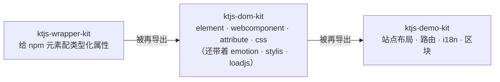

# 快速开始

## 三个模块，一个依赖

本仓库发布三个产物，多数项目只要其中一个：

| 产物 | 给谁用 | 文档 |
| --- | --- | --- |
| `ktjs-dom-kit` | 用 Kotlin/JS 写组件 | [DOM kit](../dom-kit/overview.md) |
| `ktjs-wrapper-kit` | 给 npm 组件的元素配类型化属性 | [Wrapper kit](../wrapper-kit/overview.md) |
| `ktjs-demo-kit` | 搭一个库的可运行演示站 | [Demo kit](../demo-kit/overview.md) |

依赖是单向的：`ktjs-dom-kit` 再导出 `ktjs-wrapper-kit`，`ktjs-demo-kit` 再导出这两者。只描述 npm 组件的
项目可以只依赖 `ktjs-wrapper-kit`，完全避开 DOM kit 那一边的 emotion / stylis / loadjs。




## 加依赖

```kotlin
kotlin {
    js {
        browser()
    }
    sourceSets {
        jsMain.dependencies {
            implementation("io.github.shijianjs:ktjs-dom-kit:0.1.0")
        }
    }
}
```

`kotlin-browser` 与 `kotlin-csstype` 作为 `api` 依赖一起带来：库的公开接口就是用它们的类型写的
（`web.html.HTMLElement`、`csstype.Properties`），所以已经在用 `kotlin-wrappers` 的项目不会多出一套 DOM
类型。

## 第一个元素

一个组件 = 一个继承 `CustomElementAdapter` 的类 + 一个在 companion object 里写明标签名的
`CustomElementReferenceAdapter`；companion 自己注册，没有别的调用：

```kotlin
class KtjsChip : CustomElementAdapter() {
    private val label = HtmlTagName.span.createElement {
        inlineStyle.display = Display.block
    }

    /** `text`：胶囊上的文字。 */
    @JsName("text")
    var text: String by attr { change -> label.textContent = change.newValue }

    init {
        // 构造函数不能碰 `this`，但 shadow root 是它自己的一棵树。
        val shadow = attachStyledShadow(SHEET)
        shadow.appendChild(label)
    }

    override fun connectedCallback() {
        // 已经解析出来的标记在升级时就走到了委托；这里是一次幂等的兜底，顺带按需写入默认值。
        applyInitialAttributes()
    }

    // `observedAttributes` 列出 `attributeChangedCallback` 会上报的属性，每个 `by attr` 属性一条。
    // 浏览器只在定义标签时读一次。
    companion object : CustomElementReferenceAdapter<KtjsChip>(
        KtjsChip::class.js,
        "ktjs-chip",
        observedAttributes = arrayOf("text"),
    ) {
        private val SHEET: CSSStyleSheet = cssSheet {
            pseudo(Pseudos.host) {
                display = Display.block
                padding = Padding(0.5.rem)
            }
        }
    }
}

val chip: KtjsChip = KtjsChip.NAME { text = "0.1.0" }
```

`CustomElementReferenceAdapter` 保留了原来那份引用的全部能力（类、`formAssociated`、observable 属性），
再补上两件事：`NAME` 是带类型的 `TagName`，companion 的 `init` 里调 `defineIfMissing(NAME, this)` 完成注册
（构造时传 `register = false` 就不会注册）。所以读一次 `NAME` 既会升级页面上已经写好的标签，也会新建一个
元素。

`defineIfMissing` 在注册标签之前先删掉编译器为外部 DOM 成员生成的自递归转发方法，元素体里这才可以用
`appendChild` / `querySelectorAll` 的原生拼写。漏掉这一步，元素里第一次调 DOM 方法就会一路递归到爆栈——
细节见[自定义元素](../dom-kit/custom-elements.md)。

之后这个元素就和其他自定义元素一样接受标记与属性：

```html
<ktjs-chip text="0.1.0"></ktjs-chip>
<script type="module" src="./ktjs-chip.mjs"></script>
```

## 在本仓库里开发

构建是 Gradle 多项目：库模块是 `ktjs-dom-kit`，站点是 `docs`。

```bash
./gradlew build                       # 编译、Detekt、浏览器测试
./gradlew :ktjs-dom-kit:jsBrowserTest
./gradlew :docs:docusaurusBuild       # 文档站
./gradlew pagesSite                   # 文档在 /，Dokka 在 /api/
./gradlew :docs:docusaurusStart       # 开发服务器
```

`build` 不组装 Pages 站点，那是 Pages 工作流干的事。

| 路径 | 内容 |
| --- | --- |
| `package.json` | npm 版本的唯一声明处（由 Dependabot 维护） |
| `ktjs-dom-kit/src/jsMain/kotlin` | 库的声明 |
| `ktjs-dom-kit/src/jsTest/kotlin` | 对应的浏览器测试 |
| `docs/src/jsMain/kotlin` | 站点配置与侧边栏 |
| `docs/src/jsMain/resources` | Markdown 页面、MDX 首页、CSS、翻译 |

Chromium 在第一次跑浏览器测试时由 Playwright 下载；测试本身只需要 JDK 21，npm 由 Kotlin Gradle 插件装进
workspace。

## 锁文件

npm 依赖对整个 workspace 只解析一次，钉在 `kotlin-js-store/package-lock.json`。新增或升级 npm 依赖、或者改了
模块版本之后要重新生成：

```bash
./gradlew kotlinUpgradePackageLock
```

CI 会校验提交进去的这份文件，漏了就构建失败，不会悄悄漂移。
