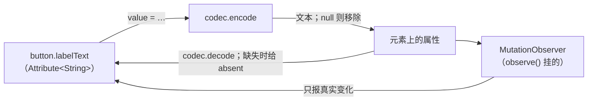

# 类型化属性

wrapper 元素是 `external` 类，它的属性通过扩展属性交出来的对象来读写：

```kotlin
val ButtonElement.labelText: Attribute<String> get() = attribute("aria-label")

button.labelText.value = "Close"      // aria-label="Close"
button.labelText.value                // "Close"
button.labelText.clear()              // 移除该属性
```

`Attribute<T>` 是**无状态**的：每次读都走 `getAttribute`，每次写都走 `setAttribute` / `removeAttribute`。
它不缓存任何东西，所以 npm 组件、devtools 或裸 `setAttribute` 写进去的值在下一次读时就是可见的 ——
不存在第二份要同步的副本。扩展属性因此可以每次访问都新建一个对象。



## 读写

| 成员 | 含义 |
| --- | --- |
| `value: T` | 解码后的值；赋值即编码写入（编码结果为 `null` 时移除属性） |
| `valueOrNull: T?` | 同 `value`，但属性缺失**或**不可解码时为 `null` |
| `raw: String?` | 浏览器里存的原始文本，属性缺失时为 `null` |
| `present: Boolean` | 元素是否带有该属性 |
| `setOrClear(value: T?)` | 写入；`null` 时移除 |
| `clear()` | 移除 |
| `observe(onChange: (T) -> Unit): AttributeWatch` | 谁写的都算，值一真变化就回调 |

`value` 与 `valueOrNull` 的区别是有意的：wrapper 的属性大多是可选的，而「缺失」不等于「空」。
`aria-label=""` 和没有 `aria-label` 是两种状态；`value` 对两者都给 codec 的 `absent`，`valueOrNull`
把它们分开。要区分就配 `setOrClear` 一起用。

## 工厂

```kotlin
fun HTMLElement.attribute(name: String): Attribute<String>                  // 缺失读作 ""
fun HTMLElement.booleanAttribute(name: String): Attribute<Boolean>          // 存在性语义，同 hidden
fun HTMLElement.intAttribute(name: String): Attribute<Int>                  // 不可读 → 0
fun HTMLElement.doubleAttribute(name: String): Attribute<Double>            // 不可读 → 0.0
fun <T> HTMLElement.attribute(name: String, codec: AttributeCodec<T>): Attribute<T>
fun <T> HTMLElement.literalAttribute(name: String, values: List<T>, token: (T) -> String): Attribute<T>
fun HTMLElement.tokenListAttribute(name: String): TokenListAttribute
fun HTMLElement.jsonAttribute(name: String): JsonAttribute
fun HTMLElement.observeAttribute(name: String, onChange: (String?) -> Unit): AttributeWatch
```

### ARIA 开关是属性，不是 attribute

ARIA 的值是文本，不是 HTML 的「存在即生效」，所以 `booleanAttribute` 表达不了它 ——
`aria-hidden="false"` 什么都隐藏不了，但 attribute 依然**存在**。这也不需要自造访问器：
`HTMLElement` 继承了 `ARIAMixin`，每个元素本来就有 `ariaHidden: AriaHidden?`、`ariaLabel:
String?`、`ariaExpanded`、`ariaPressed`、`ariaCurrent`、`ariaLive` 和 `role`，直接当属性写：

```kotlin
import web.aria.AriaHidden
import web.aria.`true` as ariaTrue

icon.ariaHidden = AriaHidden.ariaTrue        // aria-hidden="true"
```

`true` / `false` 是每个 ARIA 并集都声明一个的 Companion 扩展属性，同名，所以导入时必须起别名，
再由接收者决定是哪一种并集。只有那些没有字符串属性的 ARIA 关系（`aria-controls`、
`aria-labelledby`）才继续用 `setAttribute`。

### 字面量属性

`literalAttribute` 是固定词表的类型化写法 —— `slot="navbar"`、`orientation="horizontal"`、
`data-size="small"`。词表本身就是「拼错会解码失败」而不是「写进去被静默忽略」的原因，wrapper 直接
传自己为这套词已经生成的那张表：

```kotlin
private val SLOTS = listOf("header", "content", "footer")

val CardElement.slotName: Attribute<String>
    get() = literalAttribute("slot", SLOTS, { it })

card.slotName.setOrClear("content")     // slot="content"
```

解码忽略大小写，表里没有的文本读作**第一个**值 —— 即 `LiteralAttributeCodec.absent` 的规则。于是写
坏了的属性会退化成「还能渲染」的值，而不是在组件里抛异常。

### Token 列表

用空格分隔的词表其实是**披着字符串的集合**。把它当列表读，然后增删 token，不要重新拼整串：

```kotlin
val ThemePropertyMixin.themeAttr: TokenListAttribute get() = tokenListAttribute("theme")

button.themeAttr.add("small")
button.themeAttr.remove("contrast")
button.themeAttr.toggle("icon")
button.themeAttr.contains("primary")
```

`TokenListAttribute` 让属性文本保持规范（单空格、去重），删掉最后一个 token 就等于移除该属性。与
`DOMTokenList` 不同的是它不对畸形语法抛异常：格式不对的文本只是不算 token。`ktjs-vaadin` 正是在
`ThemePropertyMixin` 上声明了同一个访问器，并在它之上实现 `addTheme` / `setTheme` / `removeTheme`。

### JSON 属性

从标记传进来的结构（`data-options`）本质是「文本是 JSON 的属性」。`jsonAttribute` 把它解码成 `JsAny`、
也能反向编码；它适合小的结构化载荷，不适合组件该持有的类型化字段。

## Codec

`AttributeCodec<T>` 只有三件事 —— `decode(text)`、`encode(value)`、`absent`，这就是全部扩展点：

```kotlin
object InstantCodec : AttributeCodec<Instant> {
    override val absent: Instant = Instant(0)
    override fun decode(text: String): Instant = Instant(text.toDouble())
    override fun encode(value: Instant): String = value.millis.toString()
}

val TimelineElement.start: Attribute<Instant> get() = attribute("start", InstantCodec)
```

`encode` 可以返回 `null`，即移除属性 —— 可选属性用这个说「没设置」，不用编一个哨兵字符串。

## 监听

`observe`（原始文本用 `observeAttribute`）挂的是 `MutationObserver`，只报告**真实**变化：再写一遍同样的
解码值，或 `Int` 属性上的 `"3"` → `"03"`，都不会触发。移除会报告 codec 的 `absent`。返回的
`AttributeWatch` 持有活的 observer，注册它的元素消失时要断开 —— 通常在拥有元素的组件的
`disconnectedCallback` 里。

## 为什么不直接用 `attr`

`ktjs-dom-kit` 的 `attr` 委托做得更多：它给元素注册属性、保存默认值，并用 `AttributeChange`（旧值、
新值、原始文本）回调。那个委托需要一个 Kotlin 类来放属性。wrapper 没有这样的类 —— 元素类属于 npm
包 —— 所以操作挂在对象上，注册、默认值和旧值都留在「编写侧」。元素是自己的就用
[`attr`](../dom-kit/attributes.md)；描述别人的元素就用本模块。
