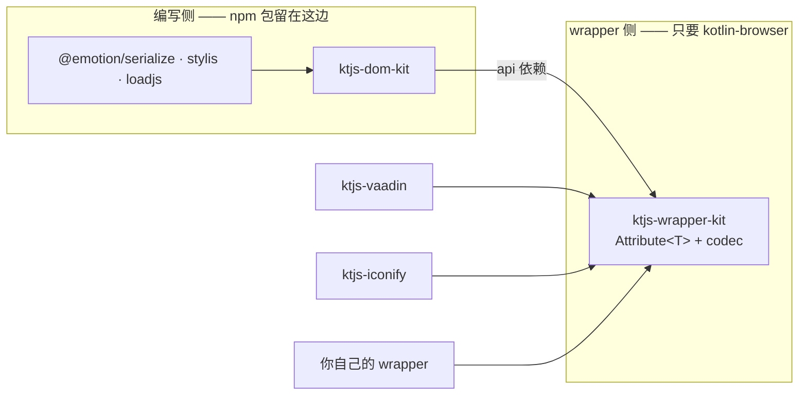

# Wrapper kit

`ktjs-wrapper-kit` 是**wrapper 库的属性层** —— 仓库里那些把 npm 包组件一对一镜像成 Kotlin 声明的库
（`ktjs-vaadin`、`ktjs-iconify` ……）用的就是它。

这些 wrapper 交回来的是 `external` 类：`createButton()` 返回的 `ButtonElement` 由 npm 包定义，Kotlin 里
只是声明。`external` 类不能加 Kotlin 成员，而 Kotlin 也不会把扩展属性委托出去，所以 wrapper 的属性
不可能写成元素上的 `by` 属性 —— 它只能是扩展属性交出来的一个对象，见[类型化属性](./attributes.md)。

## 什么放这里，什么不放

切分依据是**npm 依赖**，不是「哪些函数恰好被共用」。`ktjs-dom-kit` 的 `jsMain` 会带上
`@emotion/serialize`、`stylis`、`loadjs`；一个只想读 `card.ariaLabel = "…"` 的库不该被拖进这一串。所以
本模块只依赖 `kotlin-browser`，两边都用它：



箭头从依赖方指向被依赖方：`ktjs-vaadin` 与 `ktjs-iconify` 需要属性层，属性层只需要 DOM 类型。

这里只放 wrapper 真正需要的部分：

| 包 | 提供 |
| --- | --- |
| `io.github.shijianjs.ktjs.dom.attribute` | [`Attribute<T>`](./attributes.md) 与它的工厂：`attribute`、`booleanAttribute`、`intAttribute`、`doubleAttribute`、`attribute(name, codec)`、`literalAttribute`、`tokenListAttribute`、`jsonAttribute`、`observeAttribute` |
| `…dom.attribute.types` | 上述工厂背后的 codec —— string、boolean、int、double、literal、token list、`enumAttributeCodec`，以及给你自己类型用的 `AttributeCodec<T>` |

**不**在这里的（留在 `ktjs-dom-kit`，因为那是给**自己拥有的**元素用的，且会随 kit 的编写侧持续演进）：

- `attr` 委托，连同注册、默认值与变更回调（`AttributeChange`）；
- `CustomElementAdapter`、`defineIfMissing`、`attachStyledShadow` 等 shadow root 辅助；
- 建节点（`TagName<T>.createElement { … }`、`+tag { … }` 运算符）；
- `HTMLElement.inlineStyle` 与 `cssSheet { … }`。

wrapper 一样都用不上：它拿到的是 npm 包早就定义并配好主题的元素。

## 坐标

```kotlin
implementation("io.github.shijianjs:ktjs-wrapper-kit:0.1.0")
```

`kotlin-browser` 以 `api` 依赖带来，`HTMLElement`、`Node`、`TagName` 不用再写第二行。`ktjs-dom-kit` 会再
导出本模块，已经依赖 DOM kit 的项目不必重复声明。

## 有意保持稳定的接口

wrapper 的版本有一个「第二坐标」—— `ktjs-vaadin` 每次发版都要钉一个 wrapper-kit 版本，而 Maven Central
额度有限。所以本模块把属性 API 当作 `0.x` 里**稳定的一面**：只做加法，上面这些工厂是唯一入口，生成
在 wrapper 里的属性扩展属性永远不自己写读、写代码。
